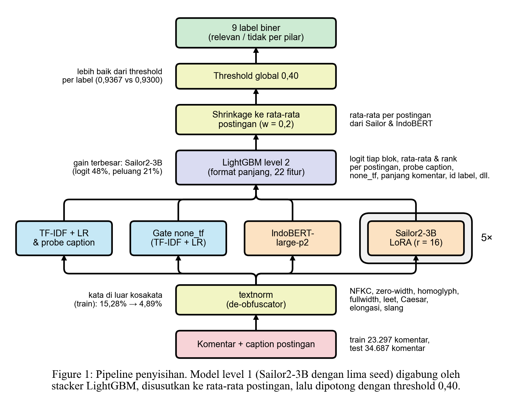
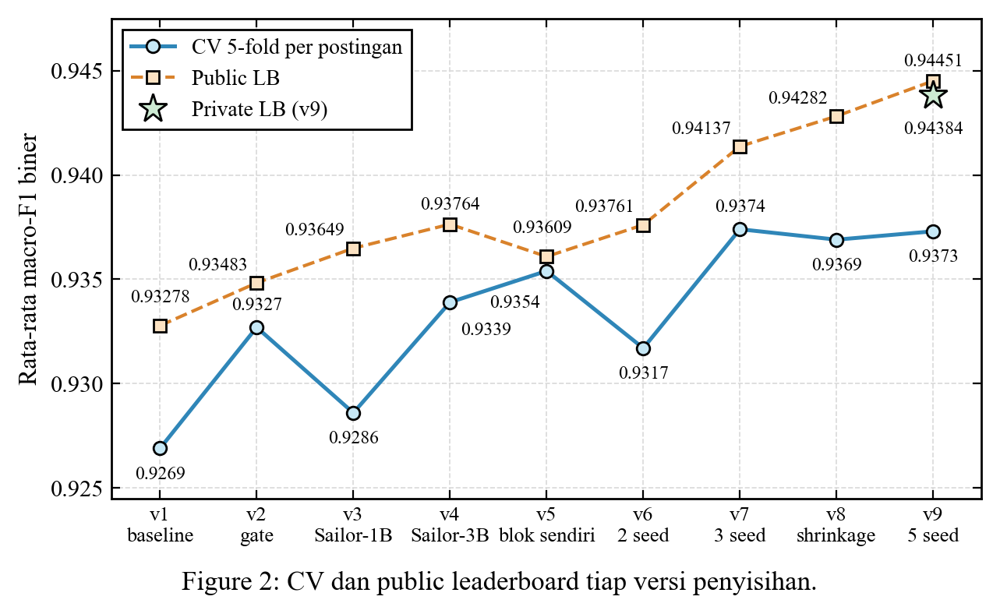
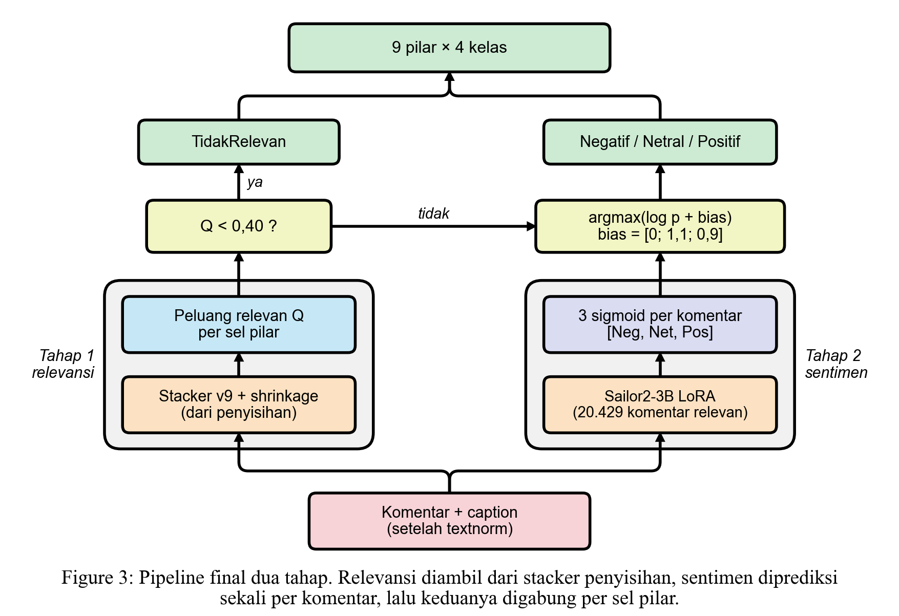
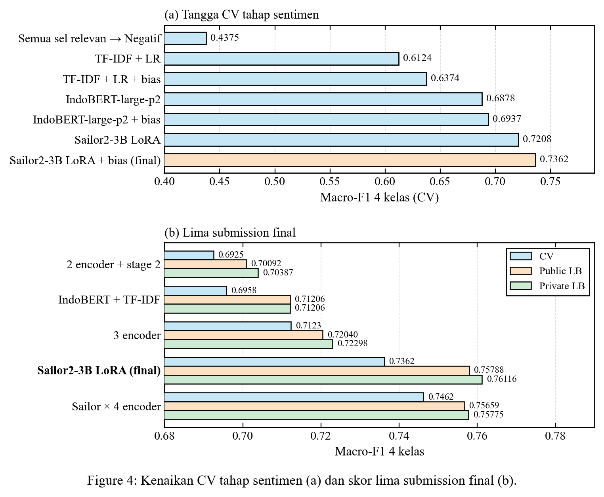

# ACTION 2026: From Complaints to Change

Writeup tim **sistemhitam** (ITS) untuk cabang Data Mining Academic Competition of Data Science (ACTION) 2026, yang diselenggarakan di Kaggle. Datanya berupa komentar warganet di media sosial tentang layanan publik, dan tugasnya memetakan setiap komentar ke sembilan pilar layanan. Tim lolos ke babak final.

| | Penyisihan | Final |
|---|---|---|
| Tugas | Multi-label: relevan atau tidak untuk 9 pilar | 4 kelas per pilar: TidakRelevan / Negatif / Netral / Positif |
| Metrik | Rata-rata macro-F1 biner per pilar | Rata-rata macro-F1 4 kelas per pilar |
| Model utama | Stacking IndoBERT + Sailor2-3B LoRA | Dua tahap: relevansi dari penyisihan + sentimen Sailor2-3B |
| CV | 0.9373 | 0.7362 |
| Public / Private LB | 0.94451 / 0.94384 | 0.75788 / 0.76116 |
| Folder | [`penyisihan/`](penyisihan) | [`final/`](final) |

## Data

Train berisi 23.297 komentar dari 105 postingan (10-497 komentar per postingan) ditambah 1.554 baris dari X tanpa caption. Test berisi 34.687 komentar dari 161 postingan baru, jadi tidak ada postingan test yang muncul di train. Setiap baris punya teks komentar, caption postingan, sumber (TikTok, Instagram, Facebook, YouTube, X), dan tanggal unggah.

Sembilan pilarnya: Infrastruktur, Kesehatan, Administrasi & Perizinan, Lingkungan & Kebersihan, Ketertiban Umum, Transportasi & Lalu Lintas, Sosial & Bantuan, Keamanan & Kriminalitas, dan Pendidikan. Sebagian besar komentar (18.166) relevan untuk tepat satu pilar, 2.868 tidak relevan sama sekali, dan sisanya relevan untuk dua pilar atau lebih.

### Teks yang sengaja diacak

Teks komentar dan caption di-obfuscate dengan berbagai cara. Polanya dan porsinya di komentar train:

| Pola | Contoh bentuk | Komentar train | Caption train |
|---|---|---|---|
| Leet | `j4l4n rus4k` | 26,7% | 43,4% |
| Elongasi | `jalaaaan` | 15,6% | 13,2% |
| Zero-width character | karakter tak terlihat di tengah kata | 13,0% | 29,2% |
| Fullwidth | `ｊａｌａｎ` | 9,0% | 39,6% |
| Homoglyph | huruf Kiril yang mirip huruf Latin | 8,1% | 42,5% |
| Huruf berspasi / bertitik | `j a l a n`, `j.a.l.a.n` | 4,1% / 4,1% | 18,9% / 17,9% |
| Caesar per kata | geser 3, 4, 5, 7, 8, 9, 11, atau 13 huruf | ada | ada |

Kami menulis modul `textnorm` untuk membalik semua pola itu secara berurutan: NFKC, buang zero-width, petakan homoglyph dan fullwidth ke Latin, gabungkan huruf berspasi atau bertitik, dekode leet dengan validasi kosakata, dekode Caesar per kata dengan skor noisy-channel dari language model trigram karakter, pendekkan elongasi, normalisasi slang, dan buang emoji di ujung. Kosakatanya 26.523 kata dari train ditambah kata dari tokenizer IndoBERT, dan modul ini diuji dengan 34 unit test. Porsi kata di luar kosakata turun dari 15,28% menjadi 4,89% di train dan dari 16,43% menjadi 6,75% di test.

### Validasi berbasis postingan

Komentar dari postingan yang sama saling mirip dan cenderung berlabel sama. K-fold acak memberi skor 0,8313, sedangkan fold yang dikelompokkan per postingan memberi 0,7413 (keduanya untuk baseline TF-IDF yang sama), jadi fold acak terlalu optimis sekitar 0,09. Karena test berisi postingan baru, kami memakai 5-fold multilabel-stratified yang dikelompokkan per postingan, dicari dengan greedy dan local search 300 restart. Baris X yang tidak punya caption dikelompokkan menjadi 994 grup berdasarkan kemiripan.

---

## Penyisihan: klasifikasi relevansi multi-label

Skor penyisihan adalah rata-rata macro-F1 biner untuk sembilan label:

$$\text{Score} = \frac{1}{9}\sum_{j=1}^{9}\frac{F1_j^{+} + F1_j^{-}}{2}$$

### Model level 1

Semua model membaca komentar bersama caption postingannya. Caption sangat membantu: baseline TF-IDF biner naik dari 0,7386 menjadi 0,8863 setelah caption ditambahkan.

- TF-IDF (kata 1-2 dan karakter 2-5) dengan regresi logistik, dipakai sebagai baseline dan sebagai probe untuk caption saja.
- Gate `none_tf`: TF-IDF LR yang memprediksi apakah komentar tidak relevan untuk pilar mana pun (AUC 0,79-0,85 per fold).
- IndoBERT-large-p2 dengan input `komentar [SEP] caption` (maksimal 256 token, komentar maksimal 160), lr 2e-5, 2 epoch, caption dropout 0,1, mean pooling, dan multi-sample dropout.
- Sailor2-3B dengan LoRA (r = 16, α = 32, di semua proyeksi attention dan MLP), prompt `Konteks postingan: {caption}\nKomentar: {komentar}`, dan head linear di atas hidden state token terakhir. KV cache untuk caption disimpan per postingan sehingga pelatihan sekitar dua kali lebih cepat. Ada pengaman jika training kolaps: run diulang dengan lr separuhnya. Lima seed dirata-rata menjadi satu blok.

### Stacking dan keputusan

LightGBM level 2 dilatih dalam format panjang (satu baris per komentar × label) dengan 22 fitur: logit tiap blok, rata-rata per postingan, rank dalam postingan, probe caption, peluang relevan, panjang komentar, ukuran postingan, `none_tf`, dan id label. Prediksinya disusutkan sedikit (w = 0,2) ke arah rata-rata per postingan dari Sailor dan IndoBERT, lalu dipotong dengan satu threshold global 0,40. Satu threshold global lebih baik daripada threshold per label (0,9367 vs 0,9300).

Sailor2-3B mendominasi stacker: logit dan peluang relevannya menyumbang 48% dan 21% gain, IndoBERT 7% dan 5%.

### Hasil penyisihan

| Versi | Perubahan utama | CV | Public LB |
|---|---|---|---|
| v1 | normalizer, CV per postingan, 6 model L1, stacker | 0.9269 | 0.93278 |
| v2 | gate dan threshold global | 0.9327 | 0.93483 |
| v3 | Sailor2-1B dirata-rata dengan IndoBERT | 0.9286 | 0.93649 |
| v4 | Sailor2-3B dirata-rata | 0.9339 | 0.93764 |
| v5 | Sailor2-3B sebagai blok sendiri | 0.9354 | 0.93609 |
| v6 | prefix cache, 2 seed | 0.9317 | 0.93761 |
| v7 | 3 seed | 0.9374 | 0.94137 |
| v8 | pengaman kolaps, refit, shrinkage | 0.9369 | 0.94282 |
| **v9** | **5 seed** | **0.9373** | **0.94451** (private 0.94384) |

Error terkonsentrasi: 20 postingan menyumbang 63% kesalahan. Dari 56 grup komentar yang teksnya identik, 18 memiliki label berbeda, bukti langsung adanya noise anotasi. Batas atas kasarnya: jika rasio label per postingan ditebak sempurna skornya 0,9468, dan jika urutan dalam postingan sempurna 0,9535.

Yang tidak membantu di penyisihan: Qwen3-4B dan Sailor2-8B 4-bit (tidak lebih baik dan dua kali lebih lambat; galat kuantisasi NF4 pada Sailor2 besar), varian attention dua arah (0,9231), refit di seluruh data (public 0.94390, lebih rendah dari 0.94451), dan 5 seed vs 3 seed yang ternyata setara pada CV 9-split.

---

## Final: relevansi dan sentimen per pilar

Di final, data dan pembagian train/test sama, tetapi setiap sel pilar sekarang punya empat kelas. Kelasnya sangat timpang: dari 209.673 sel, 89,08% TidakRelevan, 8,15% Negatif, 1,63% Positif, dan 1,14% Netral. Di dalam sel yang relevan, 74,7% Negatif. Sentimen juga hampir selalu sama di semua pilar yang relevan dalam satu komentar (92,6% baris multi-label).

Pengamatan itu membuat kami memisahkan masalah menjadi dua tahap:

1. Relevansi. Keluaran stacker penyisihan (v9 beserta shrinkage) dipakai apa adanya dengan threshold 0,40.
2. Sentimen per komentar. Model dilatih hanya pada 20.429 komentar yang relevan untuk minimal satu pilar, dengan target multi-hot tiga sigmoid [Negatif, Netral, Positif]. Kandidatnya TF-IDF + LR, IndoBERT-large-p2, dan Sailor2-3B LoRA (resep yang sama dengan penyisihan, satu seed, dibatalkan jika loss > 0,42 di 35-50% training).

Penggabungannya sederhana: sel diberi label TidakRelevan jika peluang relevan < 0,40; jika tidak, kelasnya adalah argmax(log p + bias) dengan bias [0; 1,1; 0,9] untuk [Negatif, Netral, Positif]. Bias ini dituning secara jujur (dipilih di fold lain). Dari semua kombinasi model yang dicoba, Sailor saja memberi hasil terbaik.

### Hasil final

| Submission | CV | Public | Private |
|---|---|---|---|
| 2 encoder + stage 2 | 0.6925 | 0.70092 | 0.70387 |
| IndoBERT + TF-IDF | 0.6958 | 0.71206 | 0.71206 |
| 3 encoder | 0.7123 | 0.72040 | 0.72298 |
| **Sailor2-3B LoRA (final)** | **0.7362** | **0.75788** | **0.76116** |
| Sailor × 4 encoder | 0.7462 | 0.75659 | 0.75775 |

Jalur pembanding memakai empat encoder (IndoBERTweet, NusaBERT-large, XLM-R-large, IndoBERT-large) sebagai cross-encoder dengan tiga head dan stage 2 LightGBM. Di CV jalur ini mencapai 0,7154 setelah aturan keputusan per grup, dan submission terbaiknya (3 encoder) mendapat CV 0,7123. Menggabungkan encoder dengan Sailor menaikkan CV ke 0,7462, tetapi public dan private-nya justru sedikit lebih rendah, jadi model Sailor tunggal yang dipilih.

Tangga CV tahap sentimen: semua sel relevan diberi Negatif 0,4375 → TF-IDF 0,6124 (0,6374 dengan bias) → IndoBERT 0,6878 (0,6937) → Sailor 0,7208 → Sailor + bias 0,7362.

F1 OOF per pilar untuk model final:

| Pilar | TidakRelevan | Negatif | Netral | Positif | Macro |
|---|---|---|---|---|---|
| Infrastruktur | .973 | .795 | .444 | .440 | .663 |
| Kesehatan | .996 | .887 | .540 | .874 | .824 |
| Administrasi | .990 | .831 | .656 | .664 | .786 |
| Lingkungan | .987 | .797 | .371 | .789 | .736 |
| Ketertiban | .989 | .864 | .342 | .606 | .700 |
| Transportasi | .989 | .801 | .521 | .771 | .770 |
| Sosial | .993 | .877 | .521 | .718 | .777 |
| Keamanan | .981 | .781 | .375 | .588 | .681 |
| Pendidikan | .982 | .831 | .400 | .627 | .710 |

Netral adalah kelas tersulit di semua pilar. Dari 7.142 sel yang salah, 2.021 adalah sel relevan yang terlewat, 2.575 sel yang salah dianggap relevan, dan 2.546 sel dengan sentimen salah. Jika sentimen diperbaiki sempurna skornya naik 0,1788, sedangkan relevansi sempurna hanya menambah 0,0674.

---

## Menjalankan ulang

Penyisihan (`penyisihan/notebook.ipynb`, v9, sudah dieksekusi):

- Data sudah ada di `penyisihan/data/`. Notebook menulis modul `textnorm.py`, `test_textnorm.py`, dan `cvsplit.py` sendiri lewat `%%writefile`.
- Pelatihan penuh dari nol sekitar 20-22 jam di RTX 5070 Ti Laptop (12 GB). Paket utama: transformers 4.45.2, peft, torch CUDA, lightgbm, scikit-learn.

Final (`final/notebook.ipynb`, sudah dieksekusi):

- Data sudah ada di `final/data/`. Notebook juga membaca keluaran penyisihan (`artifacts_final/penyisihan/`: fold, prediksi stacker, threshold, vocab normalizer) dan prediksi sentimen yang tersimpan (`artifacts_final/l1/`). Artefak ini tidak ikut di repo, sehingga untuk menjalankan ulang tahap relevansi perlu menjalankan notebook penyisihan terlebih dahulu.
- Output yang tersimpan berasal dari run "replay": model dimuat dari prediksi yang tersimpan dan log pelatihan aslinya dicetak ulang.
- Run final memakai transformers 4.57.6 di RTX 5060 Ti 16 GB.

Model pralatih yang dipakai: `sail/Sailor2-3B`, `indobenchmark/indobert-large-p2`, dan untuk jalur pembanding `indolem/indobertweet-base-uncased`, `LazarusNLP/NusaBERT-large`, `FacebookAI/xlm-roberta-large`. Tidak ada data eksternal.

## Isi folder

| Berkas | Keterangan |
|---|---|
| `penyisihan/notebook.ipynb` | Notebook v9 dengan output |
| `penyisihan/submission.csv` | Submission penyisihan v9, 34.687 baris |
| `penyisihan/data/` | `train.csv`, `test.csv`, `sample_submission.csv` |
| `final/notebook.ipynb` | Notebook final dua tahap dengan output |
| `final/submission.csv` | Submission final (Sailor2-3B), 34.687 baris |
| `final/data/` | `train.csv`, `test.csv`, `sample_submission.csv` babak final |
