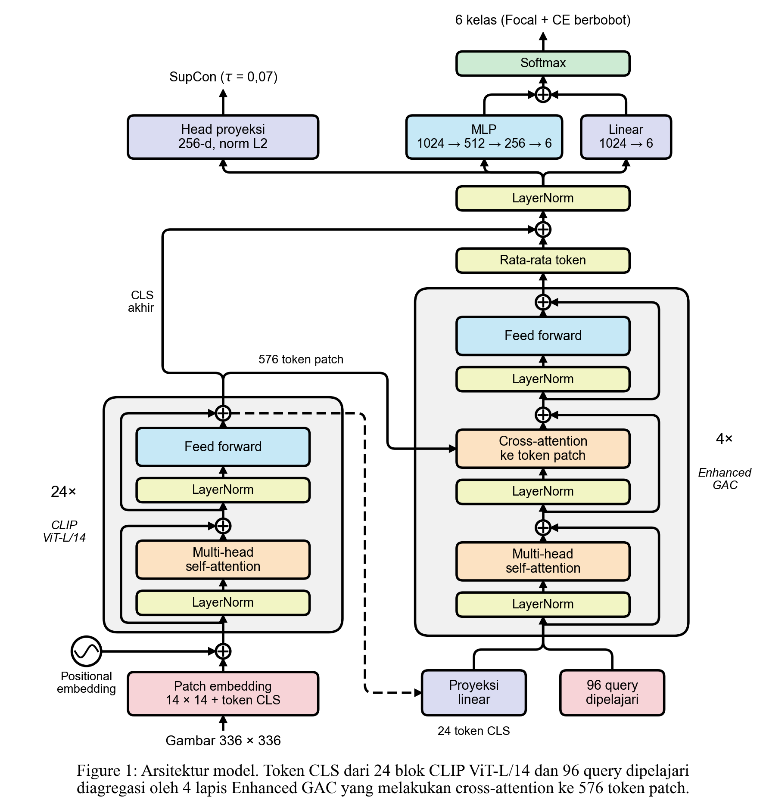
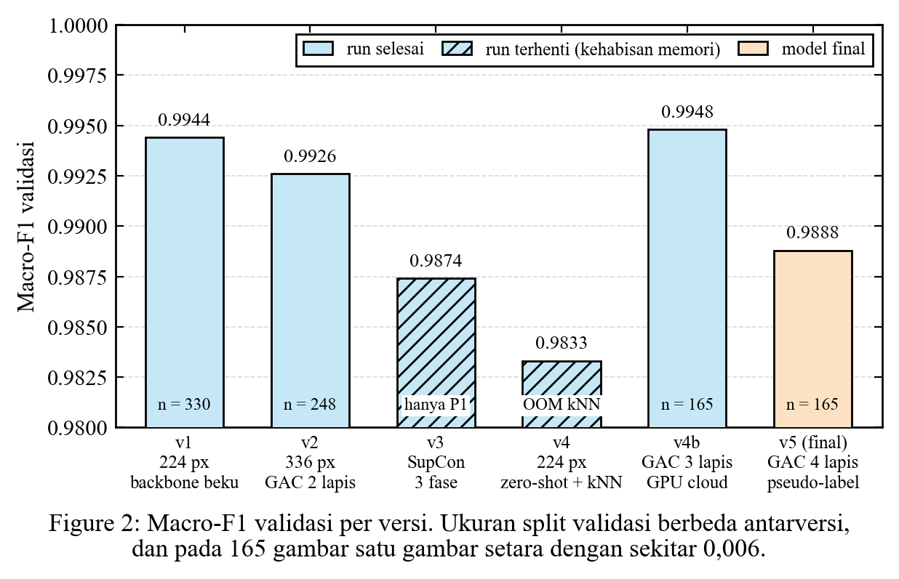

# DAC 2026: Face Anti-Spoofing 6 Kelas

Writeup untuk kompetisi Kaggle klasifikasi face anti-spoofing di lomba DAC (April 2026). Setiap foto wajah harus dikenali sebagai orang asli atau salah satu dari lima jenis serangan palsu. Solusinya memakai CLIP ViT-L/14@336px dengan modul agregasi lintas lapisan ala I-FAS, dan mencapai macro-F1 validasi sekitar 0,99. Kode yang sama juga dipublikasikan di [tamamfb/fas_clip](https://github.com/tamamfb/fas_clip).

| | |
|---|---|
| Tugas | Klasifikasi gambar 6 kelas |
| Metrik | Macro-F1 (benchmark panitia 0.96063) |
| Data | 1.648 gambar train, 404 gambar test |
| Validasi | Split stratified 90/10 (165 gambar validasi) |
| Skor validasi | Macro-F1 0.9888 pada split asli; skor leaderboard tidak tercatat |

## Masalah dan data

| Kelas | Arti | Jumlah train |
|---|---|---|
| `realperson` | wajah asli (termasuk yang memakai masker kain atau medis) | 424 |
| `fake_unknown` | serangan lain | 356 |
| `fake_mask` | foto wajah yang ditempelkan ke wajah | 292 |
| `fake_mannequin` | manekin | 230 |
| `fake_screen` | wajah ditampilkan di layar | 204 |
| `fake_printed` | foto cetak yang dipegang di depan wajah | 142 |

Rasio kelas terbesar ke terkecil 2,99. Ukuran gambar sangat beragam, dengan lebar median 960 piksel dan tinggi median 1.280 piksel. Perbedaan `fake_mask` dan `fake_printed` (foto ditempel ke wajah vs foto dipegang) baru kami pahami dari umpan balik submission di Kaggle. Dataset lengkap sekitar 1,2 GB dan berisi foto wajah; lihat [data/README.md](data/README.md).

Ada jalan pintas yang perlu diwaspadai: hampir semua gambar `fake_unknown` adalah berkas `.jpeg` kecil. Di submission final, 46 dari 48 berkas `.jpeg` di test diprediksi `fake_unknown`.

## Model

Model mengikuti ide I-FAS (AAAI 2025): fitur dari semua lapisan CLIP, bukan hanya lapisan terakhir, dikumpulkan oleh modul agregasi berbasis query.

1. Backbone CLIP ViT-L/14@336px. Forward hook mengambil token CLS dari ke-24 blok, ditambah 576 token patch dan CLS akhir.
2. Enhanced GAC (Global Aggregation Component): 96 query yang dipelajari ditambah 24 token CLS yang diproyeksikan, melewati 4 lapisan [self-attention → cross-attention ke token patch → FFN] dengan 8 head dan DropPath sampai 0,1.
3. Classifier: rata-rata keluaran GAC dijumlahkan dengan CLS akhir, LayerNorm, lalu MLP 1024 → 512 → 256 → 6 (dropout 0,4) dengan jalur pintas Linear(1024, 6).
4. Head proyeksi 256 dimensi (dinormalisasi L2) untuk supervised contrastive loss.

Totalnya 498 juta parameter, dengan 70 juta yang dilatih di fase pertama.

Loss-nya 0,6 · Focal (γ = 2) + 0,4 · cross-entropy berbobot kelas (keduanya dengan label smoothing 0,08), ditambah 0,2 · SupCon (τ = 0,07) pada batch tanpa MixUp. Augmentasinya RandomResizedCrop, flip, color jitter, blur, grayscale, grid distortion, noise, coarse dropout, dan MixUp (p = 0,5).

### Pelatihan bertahap

| Fase | Yang dilatih | LR (CLIP / GAC / head) | Epoch maks |
|---|---|---|---|
| P1 | GAC + head, CLIP beku | - / 3e-4 / 1e-3 | 35 |
| P2 | + 12 blok terakhir CLIP | 5e-7 / 5e-6 / 5e-5 | 30 |
| P3 | + semua 24 blok | 3e-8 / 5e-7 / 5e-6 | 20 |

Setelah itu pseudo-label dijalankan tiga putaran dengan ambang kepercayaan 0,998, 0,97, dan 0,92. Putaran pertama tidak menambah gambar apa pun, putaran kedua menambah 44 gambar test, dan putaran ketiga 107 gambar. Setiap kali, model dilatih ulang dari checkpoint terbaik dengan LR yang lebih kecil.

### Inferensi

Tiga seed tambahan (123, 456, 999) dilatih P1 → P3 pada data yang sudah diperluas. Keempat model diprediksi dengan 20 view TTA, dan hasilnya dirata-rata. Prediksi akhir adalah 0,55 · ensemble jaringan + 0,25 · zero-shot CLIP (4 prompt per kelas) + 0,20 · kNN (k = 15) pada embedding CLIP gambar train.

## Hasil

| Versi | Perubahan utama | Macro-F1 validasi |
|---|---|---|
| v1 | ViT-L/14@224 beku, GAC 1 lapis 32 query | 0.9944 (330 gambar) |
| v2 | 336 piksel, GAC 2 lapis, focal + wCE, MixUp, buka 4 blok terakhir | 0.9926 (248) |
| v3 | SupCon, 3 fase | 0.9874 di P1; P2 kehabisan memori di laptop |
| v4 | kembali ke 224, tambah zero-shot dan kNN | 0.9833; CUDA OOM saat ekstraksi kNN |
| v4b | GAC 3 lapis, 3 fase, di GPU cloud | 0.9948 (165) |
| **v5 (final)** | GAC 4 lapis 96 query, 2 putaran pseudo-label, 4 model | 0.9888 (165) |

Beberapa catatan jujur tentang angka di atas:

- Validasi sudah jenuh sejak awal. Model v1 yang backbone-nya beku sudah mencapai 0,9944, dan fase P2 serta P3 tidak pernah menaikkan F1 validasi di run mana pun. Dengan 165 gambar validasi, selisih satu gambar sudah mengubah skor sekitar 0,006.
- Skor 0,9946 setelah pseudo-label putaran 3 tidak sebanding dengan angka lain, karena split validasinya dibuat ulang dari data yang sudah berisi gambar test berlabel semu. Pada split validasi asli (165 gambar), model yang sama mendapat 0,9888, sama dengan sebelum pseudo-label.
- Ensemble, bobot blend, dan TTA tidak pernah divalidasi terpisah. Submission v4b dan v5 hanya berbeda di 5 dari 404 gambar.

Error yang tersisa di validasi v5 hanya dua: satu `realperson` dan satu `fake_unknown` yang salah kelas. Recall `realperson` 0,9767 dan `fake_unknown` 0,9722.

Masalah praktis yang mendorong pindah dari laptop ke GPU cloud (Modal): v3 kehabisan RAM saat P2, dan v4 kehabisan memori GPU karena hook menimbun token CLS di buffer selama `encode_image`. Perbaikannya adalah mengosongkan buffer sebelum dan sesudah setiap forward.

## Menjalankan ulang

1. Unduh data (lihat [data/README.md](data/README.md)). Notebook ditulis untuk Modal dan membaca data dari `/data/fas` (`BASE_DIR` di sel konfigurasi). Ganti nilai itu ke `data` untuk menjalankan secara lokal.
2. Pasang `git+https://github.com/openai/CLIP.git`, albumentations 2.0.8, torch (dijalankan dengan 2.8.0, CUDA 12.9), scikit-learn, pandas. Bobot ViT-L/14@336px (891 MB) diunduh otomatis.
3. Jalankan `notebook.ipynb`. Run final memakai GPU H200, dengan sekitar 25-30 detik per epoch. Checkpoint akhir sekitar 1,5 GB per model dan tidak disimpan di repo.

Notebook mengeluarkan label `fake_print`; sel terakhir memetakannya kembali ke `fake_printed` sesuai format submission.

## Isi folder

| Berkas | Keterangan |
|---|---|
| `notebook.ipynb` | Notebook final v5 dengan output (kurva training dan distribusi prediksi, tanpa foto wajah) |
| `submission.csv` | Submission final, 404 baris |
| `data/` | Petunjuk unduh dataset |
