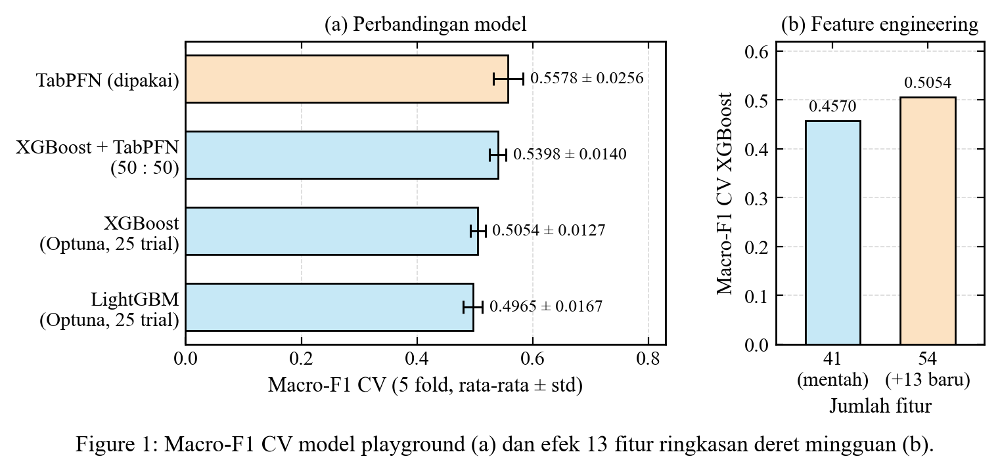
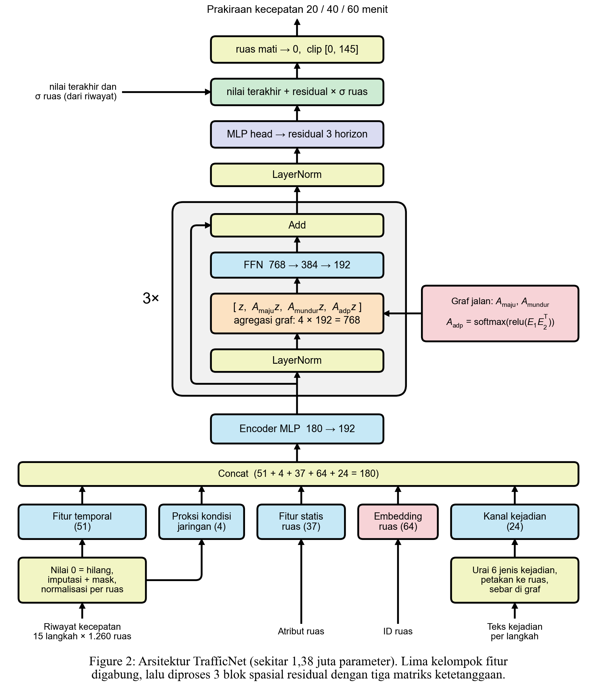
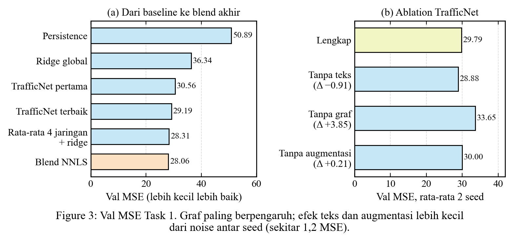
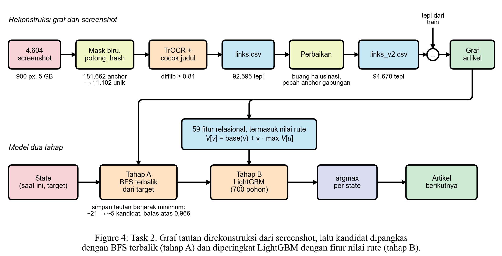
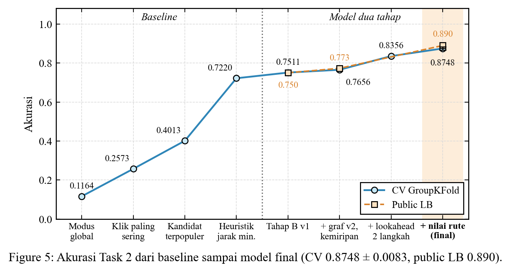

# Datathon UI 2026

Writeup tim **doremifasolasido** untuk Datathon UI (Juli 2026). Lomba ini terdiri dari satu babak latihan (playground) dan dua task utama yang sangat berbeda: prakiraan kecepatan lalu lintas dengan konteks teks kejadian, dan prediksi klik berikutnya di permainan Wikispeedia.

| | Playground | Task 1: Lalu lintas | Task 2: Wikispeedia |
|---|---|---|---|
| Tugas | Klasifikasi 4 level performa siswa | Prakiraan kecepatan 1.260 ruas jalan, 20/40/60 menit ke depan | Menebak artikel yang diklik berikutnya |
| Metrik | Macro-F1 (dipakai untuk memilih model) | MSE | Akurasi |
| Model akhir | TabPFN | TrafficNet (MLP spasial-temporal berbasis graf) + ridge | Reverse BFS + LightGBM dengan fitur nilai rute |
| Skor | CV macro-F1 0.5578 | Val MSE 28.058 | CV 0.8748, public LB 0.890 |
| Folder | [`playground/`](playground) | [`task-1-traffic/`](task-1-traffic) | [`task-2-wikispeedia/`](task-2-wikispeedia) |

---

## Playground: level performa siswa

Data sintetis berisi 3.200 siswa train dan 800 test dengan 41 fitur: nilai mingguan (12 kolom), aktivitas harian (16 kolom), skor motivasi dan kedisiplinan, tugas selesai dan tugas diberikan, skor tryout, dan beberapa fitur lain. Target 4 kelas (0 sampai 3) hampir seimbang. Tidak ada nilai kosong.

Fitur mentah lemah; korelasi tertingginya dengan target hanya 0,215 (`tugas_selesai`). Ringkasan deret mingguan jauh lebih informatif, jadi ditambahkan 13 fitur: mean, std, min, max, dan kemiringan OLS untuk nilai mingguan dan aktivitas, `completion_rate = tugas_selesai / tugas_diberikan`, `tryout_per_urutan`, dan `motivasi × disiplin`. `completion_rate` (korelasi 0,405) dan `nilai_minggu_std` (0,396) langsung menjadi fitur terkuat. Dengan XGBoost, fitur tambahan ini menaikkan macro-F1 CV dari 0,4570 ke 0,5054.

| Model (StratifiedKFold 5 fold) | Akurasi | Macro-F1 | Log-loss |
|---|---|---|---|
| **TabPFN (dipakai)** | 0.5650 ± 0.0266 | **0.5578 ± 0.0256** | 0.9563 |
| 0,5 XGBoost + 0,5 TabPFN | 0.5516 ± 0.0154 | 0.5398 ± 0.0140 | 0.9776 |
| XGBoost (Optuna, 25 trial) | 0.5166 ± 0.0153 | 0.5054 ± 0.0127 | 1.0476 |
| LightGBM (Optuna, 25 trial) | 0.5075 ± 0.0176 | 0.4965 ± 0.0167 | 1.0527 |

TabPFN, model fondasi untuk data tabular kecil, mengalahkan GBDT yang sudah dituning dengan selisih sekitar 0,05. Kesalahan terbanyak ada di dua kelas tengah: F1 kelas 1 dan 2 sekitar 0,41-0,42, sedangkan kelas 0 dan 3 sekitar 0,69-0,71.

---

## Task 1: Prakiraan kecepatan lalu lintas dengan teks kejadian

Submission Task 1 terlambat dikirim, setelah leaderboard ditutup, jadi tidak masuk peringkat resmi. Writeup awal kami mencatat bahwa skornya setara peringkat ke-4 jika dibandingkan dengan leaderboard akhir, tetapi angka MSE test-nya tidak tersimpan.

### Masalah dan data

Datanya berasal dari BjTT (Beijing Text-Paired Traffic): kecepatan (km/jam) di 1.260 ruas jalan Beijing dengan langkah 4 menit, ditambah paragraf teks kejadian di setiap langkah waktu (misalnya `accident on <lokasi>`, `road closure on <lokasi>`). Dari riwayat 15 langkah (1 jam), model harus memprakirakan kecepatan 5, 10, dan 15 langkah ke depan (20, 40, 60 menit). Skornya MSE di semua sel (sampel, horizon, ruas), termasuk sel yang nilai aslinya 0.

| | Ukuran |
|---|---|
| Train bulan 1 | 11.160 langkah × 1.260 ruas (31 hari), 1,0% nol |
| Train bulan 2 | 5.039 langkah × 1.260 ruas (~14 hari), 16,7% nol |
| Test | 540 jendela × 15 langkah × 1.260 ruas |
| Graf jalan | 1.260 × 1.260 berarah, rata-rata out-degree 4,07 |

### Temuan dari EDA

- Nilai 0 berarti sensor mati, bukan jalan macet total. Jika langkah terakhir riwayat bernilai 0, target hampir pasti 0 juga (P = 0,998 di bulan 1, 0,9997 di bulan 2), dan jika tidak, target hampir tidak pernah 0. Karena itu 0 diperlakukan sebagai data hilang, dan ruas yang seluruh riwayatnya 0 diprediksi tepat 0.
- Jam dalam sehari tidak bisa dipulihkan. Mencocokkan riwayat atau teks ke data train hanya memberi galat median 84 dan 324 menit, hampir sama dengan tebakan acak.
- Teks berkorelasi dengan residual kecepatan (jumlah kecelakaan −0,42, penutupan jalan +0,24), tetapi informasi itu ternyata sudah terkandung di riwayat kecepatan.

### Model: TrafficNet

Model ini tidak bergantung pada jam dan termasuk keluarga STID/STAEformer, dengan sekitar 1,38 juta parameter.

1. Riwayat 15 langkah: nilai 0 diisi dengan nilai terakhir yang valid (lalu backward fill, atau rata-rata ruas jika semuanya hilang), disertai mask data hilang. Nilai dinormalisasi per ruas.
2. Fitur temporal per ruas (51): nilai ternormalisasi, selisih antar langkah, flag hilang, dan 7 ringkasan (mean, std, min, max, kemiringan, selisih terakhir dengan mean, fraksi hilang).
3. Empat proksi kondisi jaringan per jendela sebagai pengganti jam: rata-rata sel hidup, rata-rata langkah terakhir, kemiringan rata-rata, dan fraksi ruas yang melambat.
4. Fitur statis per ruas (37): koordinat, panjang, arah, posisi grid, degree, statistik kecepatan train, dan distribusi kelas jalan; ditambah embedding ruas 64 dimensi yang dipelajari.
5. Kanal kejadian (24): teks diurai menjadi 6 jenis kejadian, lokasinya dipetakan ke ruas lewat pencocokan nama jalan Mandarin ke Inggris (aturan sufiks, ring road, pypinyin, difflib), lalu disebarkan ke tetangga maju dan mundur di graf.
6. Encoder MLP (180 → 192), lalu 3 blok spasial residual. Setiap blok menggabungkan [z, A_maju·z, A_mundur·z, A_adaptif·z] dan memprosesnya dengan FFN, dengan A_adaptif = softmax(relu(E1·E2ᵀ)).
7. Head memprediksi residual dalam satuan σ ruas untuk 3 horizon: prediksi = nilai terakhir + residual × σ.

Model dilatih dengan masked MSE pada sel yang targetnya > 0, AdamW, OneCycle 12 epoch, dropout 0,25, dan augmentasi data hilang. Validasi memakai 6 hari terakhir bulan 1 dan 3 hari terakhir bulan 2.

### Hasil Task 1

| Model | Val MSE |
|---|---|
| Persistence (nilai terakhir + aturan ruas mati) | 50.89 |
| Ridge global pada riwayat 15 langkah | 36.34 |
| TrafficNet pertama (35 epoch, dropout 0,1) | 30.56 |
| TrafficNet, konfigurasi terbaik (12 epoch, dropout 0,25; seed 0) | 29.19 |
| Rata-rata sederhana 4 jaringan (2 seed × dengan/tanpa teks) + ridge | 28.31 |
| **Blend NNLS** | **28.06** |

| Varian (rata-rata 2 seed) | Val MSE | Δ |
|---|---|---|
| Lengkap | 29.79 | |
| Tanpa teks | 28.88 | −0.91 |
| Tanpa graf | 33.65 | +3.86 |
| Tanpa augmentasi | 30.00 | +0.21 |

Angka ablation adalah rata-rata dua seed, jadi baris "Lengkap" (29,79) lebih tinggi dari skor seed 0 saja (29,19). Graf adalah komponen terpenting. Cabang teks justru sedikit merugikan, sehingga blend akhir memberi bobot terbesar pada jaringan tanpa teks (0,38 dan 0,32), lalu ridge (0,16) dan jaringan dengan teks seed 0 (0,14); jaringan dengan teks seed 1 mendapat bobot 0. Perlu dicatat, noise antar seed sekitar 1,2 MSE, lebih besar dari efek teks dan augmentasi. Bobot blend juga di-fit pada set validasi yang sama dengan yang dipakai memilih epoch terbaik, jadi 28,06 sedikit optimis.

---

## Task 2: Prediksi klik berikutnya di Wikispeedia

### Masalah dan data

Di Wikispeedia, pemain berpindah dari satu artikel Wikipedia ke artikel target hanya dengan mengklik tautan. Diberikan artikel saat ini dan artikel target, tugasnya menebak tautan yang diklik pemain berikutnya. Train berisi 9.000 state (360 target × 25) dan test 6.000 state (240 target × 25). Target train dan test sama sekali tidak beririsan, walaupun 87,4% artikel "saat ini" di test juga muncul di train.

Masalah utamanya: daftar tautan antar artikel tidak diberikan. Yang ada hanya 4.604 screenshot halaman artikel (lebar 900 piksel, total 5 GB) dengan tautan berwarna biru `#0B00EE`.

### Memulihkan graf dari screenshot

1. Mask piksel biru, potong per baris teks, gabungkan potongan yang berdekatan, lalu hash setiap potongan. Dari 181.662 anchor terdapat 11.102 render unik.
2. OCR dengan TrOCR (`microsoft/trocr-base-printed`), lalu cocokkan ke 4.604 judul artikel (difflib ≥ 0,84). Hasilnya `links.csv` dengan 92.595 tepi.
3. Perbaikan: 41% render tidak cocok ke judul mana pun. Sebanyak 71,5% kegagalan ini adalah halusinasi OCR dari serpihan garis bawah dan dibuang, sedangkan 15,6% adalah anchor yang tergabung dan dipecah kembali menjadi judul yang dikenal. Hasilnya `links_v2.csv` dengan 94.670 tepi, dan recall kandidat naik dari 0,9806 ke 0,9936.

### Model dua tahap

- Tahap A: BFS terbalik dari artikel target (kedalaman maksimal 8). Hanya tautan di halaman saat ini yang jaraknya ke target minimum yang dipertahankan, sehingga kandidat menyusut dari sekitar 21 menjadi sekitar 5 per state. Jawaban benar masih ada di kandidat pada 96,6% state.
- Tahap B: LightGBM (700 pohon) memilih satu kandidat per state berdasarkan 59 fitur relasional: degree, kemiripan kategori dengan target, tetangga bersama, Adamic-Adar, prior klik out-of-fold, lookahead dua langkah, dan versi rank-nya di dalam state.

Lompatan terbesar datang dari fitur nilai rute. Alih-alih menilai satu kandidat, fitur ini menilai rute terbaik dari kandidat ke target: V[v] = base(v) + γ·max{V[u] : u tetangga v yang satu langkah lebih dekat ke target}, dihitung sekali jalan per level BFS. Base yang dipakai adalah log in-degree, prior, dan Jaccard kategori, dengan γ antara 0,5 dan 1,0. Fitur `r_v_ind_10` (in-degree, γ = 1) sendiri memegang 47,5% gain model final.

Validasi memakai GroupKFold per target. Graf dan prior dibangun ulang di setiap fold, karena prior yang dihitung di luar fold menggelembungkan CV sekitar 4 poin.

### Hasil Task 2

| Tahap | CV akurasi | Public LB |
|---|---|---|
| Modus global | 0.1164 | |
| Klik paling sering dari halaman saat ini | 0.2573 | |
| Kandidat paling populer di halaman | 0.4013 | |
| Heuristik jarak minimum | 0.7220 | |
| Tahap B v1 (graf awal, 7 fitur + prior) | 0.7511 | 0.750 |
| + graf v2, tepi dari train, fitur kemiripan graf | 0.7656 | 0.773 |
| + lookahead dua langkah | 0.8356 | |
| **+ fitur nilai rute (final)** | **0.8748 ± 0.0083** | **0.890** |

Kualitas graf sangat menentukan. Jika hanya 90% tepi dipertahankan, batas atas tahap A turun dari 0,966 ke 0,841 dan akurasi dari 0,766 ke 0,664. Yang tidak membantu: embedding judul MiniLM (−0,001), TF-IDF (−0,002), personalized PageRank (−0,003), LambdaRank, ensemble seed, tuning hyperparameter, dan melonggarkan tahap A ke jarak minimum + 1 (−0,050).

---

## Menjalankan ulang

Playground: data ada di `playground/data/`. Notebook memasang lightgbm, xgboost, optuna, dan tabpfn sendiri jika belum ada; TabPFN mengunduh bobotnya saat pertama dipakai.

Task 1:

- Data sekitar 189 MB dan tidak disimpan di repo; lihat [`task-1-traffic/data/README.md`](task-1-traffic/data/README.md).
- Notebook menulis modul `src/*.py` lewat `%%writefile`. Sel tabel sweep dan ablation membaca `artifacts/sweep.json` dan `artifacts/ablation.json`, jadi jalankan `src/sweep.py` dan `src/ablate.py` dulu. Tanpa `artifacts/ensemble.json`, sel final melatih ulang ensemble (sekitar 40 menit GPU).
- Paket: torch (CUDA disarankan), numpy, scipy, pandas, pypinyin.
- `submission.csv` berukuran 58 MB (2.041.200 baris).

Task 2:

- Semua CSV yang dibutuhkan ada di `task-2-wikispeedia/data/`, termasuk graf hasil rekonstruksi (`links.csv`, `links_v2.csv`). Screenshot hanya dibutuhkan untuk membangun ulang graf; lihat [`task-2-wikispeedia/data/README.md`](task-2-wikispeedia/data/README.md).
- Paket: numpy, pandas, scikit-learn, lightgbm. Sel eksperimen embedding judul memakai sentence-transformers (`all-MiniLM-L6-v2`) dan mengunduhnya jika cache tidak ada.

## Isi folder

| Berkas | Keterangan |
|---|---|
| `playground/notebook.ipynb`, `submission.csv`, `data/` | Notebook TabPFN dengan output, submission 800 baris, dan data |
| `task-1-traffic/notebook.ipynb`, `submission.csv`, `data/` | Notebook TrafficNet dengan output, submission 2.041.200 baris, petunjuk unduh data |
| `task-2-wikispeedia/notebook.ipynb`, `submission.csv`, `data/` | Notebook dua tahap dengan output, submission 6.000 baris, CSV lomba dan graf hasil rekonstruksi |
