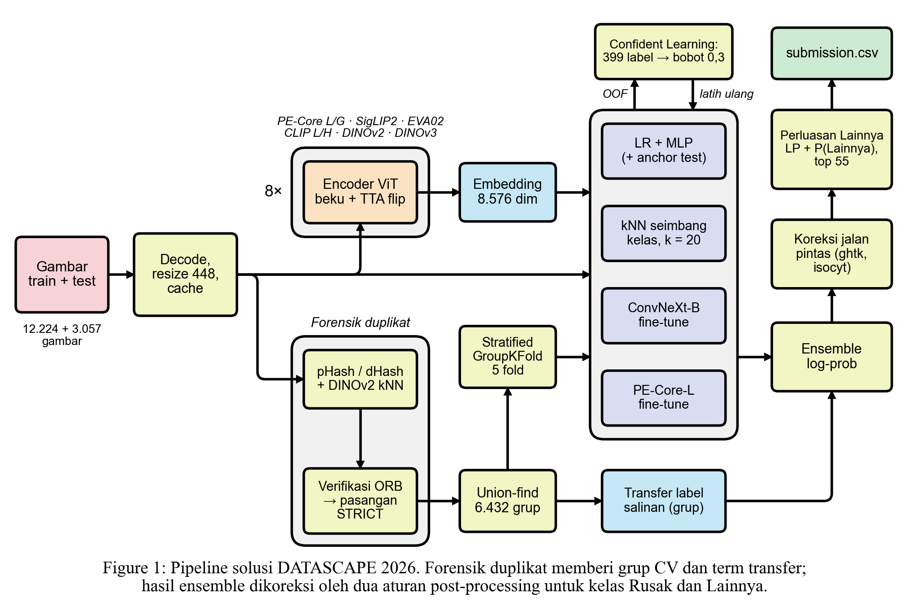
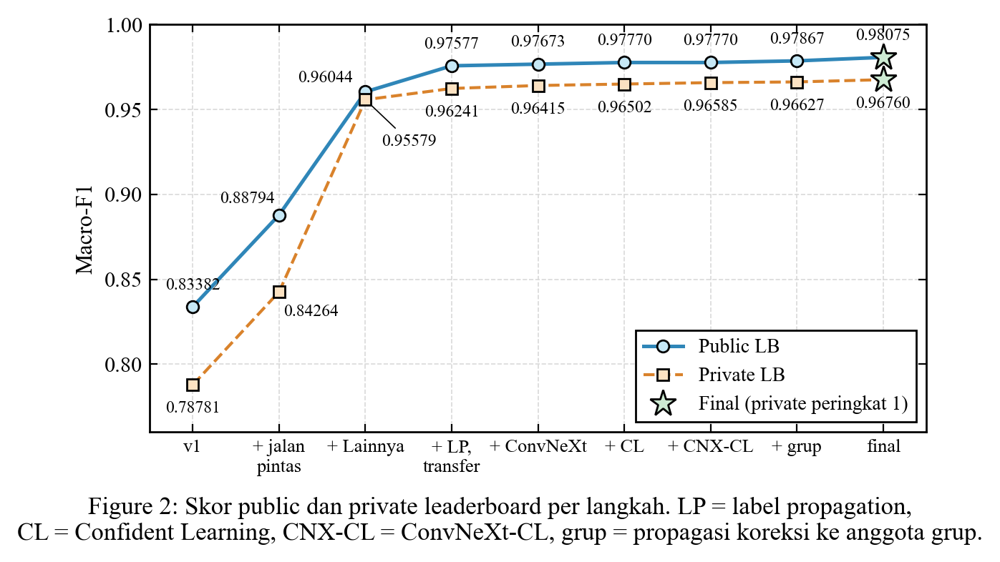
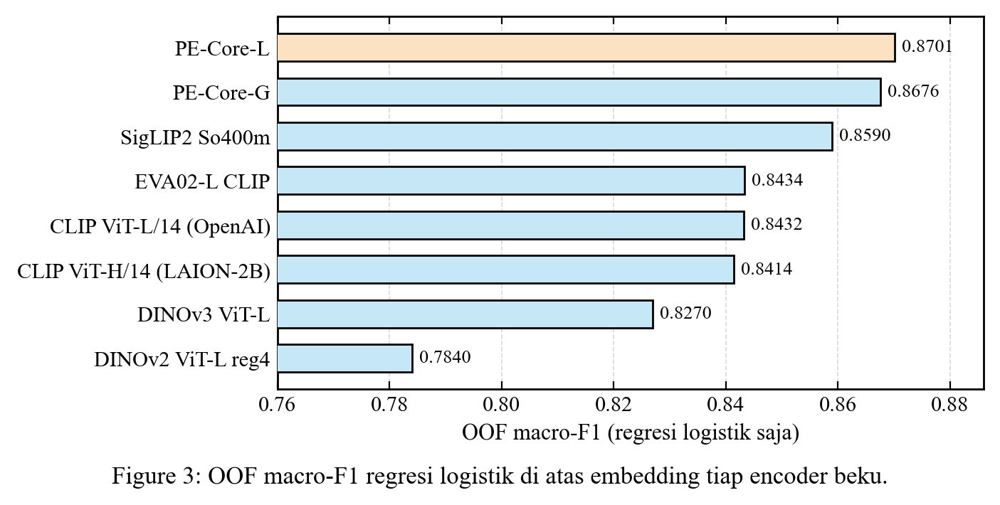

# DATASCAPE 2026: E-Commerce Package Quality Control

Writeup tim **sistemhitam** untuk kompetisi data mining [DATASCAPE 2026](https://www.kaggle.com/competitions/datascape-2026-data-mining-competition) di Kaggle (Oktober 2026). Tugasnya mengklasifikasikan foto paket e-commerce menjadi Aman, Rusak, atau Lainnya. Solusi ini menempati **peringkat 1 dari 91 tim** di private leaderboard (macro-F1 0.96760) dan peringkat 2 di public leaderboard (0.98075), lalu maju ke babak final.

| | |
|---|---|
| Tugas | Klasifikasi gambar 3 kelas |
| Metrik | Macro-F1 |
| Data | 12.224 gambar train, 3.057 gambar test |
| Validasi | StratifiedGroupKFold 5 fold, grup dari deteksi duplikat |
| Skor akhir | Public 0.98075 (peringkat 2), private 0.96760 (peringkat 1) |

## Masalah dan data

| Kelas | Arti | Jumlah train |
|---|---|---|
| Aman | kardus standar dalam kondisi utuh | 8.800 |
| Rusak | kemasan rusak | 3.001 |
| Lainnya | kemasan non-standar: plastik, kantong kertas, kemasan makanan | 423 |

Perbandingan kelasnya 20,8 : 7,1 : 1. Satu berkas train (`Aman_06692.jpg`) sebenarnya AVIF dan tidak terbaca oleh Pillow 10.2, sehingga yang terpakai 12.223 gambar. Formatnya campur aduk: 1.968 berkas adalah WEBP berekstensi `.jpg`, ada PNG berekstensi `.jpg`, 132 gambar RGBA atau palet, dan 2 gambar dengan rotasi EXIF. Ukurannya juga beragam, dari sisi terpendek 37 piksel sampai sisi terpanjang 8.000 piksel. Dataset lengkap sekitar 3,3 GB; lihat [data/README.md](data/README.md).

## Tiga masalah tersembunyi

Pekerjaan terbesar bukan memilih backbone, tetapi menemukan tiga sifat data berikut.

Pertama, 60% test adalah salinan gambar train. Dengan hash perseptual, pencocokan ORB, dan kemiripan DINOv2, 1.831 dari 3.057 gambar test (59,9%) ternyata punya salinan berlabel di train. Jika label salinan itu disalin langsung, akurasinya 0,9722 (0,9854 untuk grup yang labelnya seragam).

Kedua, augmentasi yang sudah tertanam di gambar menjadi jalan pintas label. Sebanyak 49,9% gambar Aman di train sudah diaugmentasi (noise, rotasi dengan border hitam, grayscale), sedangkan di test hanya 12,6%. Model belajar "gambar bersih berarti Rusak" pada sumber tertentu, dan aturan ini salah di test.

Ketiga, separuh kelas Lainnya tersembunyi. Dari probe submission satu kelas, test diperkirakan berisi sekitar 107 gambar Lainnya, sedangkan model awal hanya menemukan separuhnya. Kelas sekecil ini sangat mempengaruhi macro-F1.

## Pendekatan

### Decode dan embedding

Semua gambar dibuka dengan Pillow (EXIF transpose, RGBA ditempel ke latar putih), di-resize bicubic ke 448×448, lalu disimpan ke satu cache. Delapan encoder beku mengekstrak embedding dengan TTA flip horizontal:

| Encoder | Input | Dimensi | OOF macro-F1 (LR saja) |
|---|---|---|---|
| PE-Core-L (`vit_pe_core_large_patch14_336.fb`) | 336 | 1024 | 0.8701 |
| PE-Core-G (`vit_pe_core_gigantic_patch14_448.fb`) | 448 | 1536 | 0.8676 |
| SigLIP2 So400m | 384 | 1152 | 0.8590 |
| EVA02-L CLIP | 336 | 1024 | 0.8434 |
| CLIP ViT-L/14 (OpenAI) | 336 | 768 | 0.8432 |
| CLIP ViT-H/14 (LAION-2B) | 224 | 1024 | 0.8414 |
| DINOv3 ViT-L | 448 | 1024 | 0.8270 |
| DINOv2 ViT-L reg4 | 448 | 1024 | 0.7840 |

### Forensik duplikat dan grup CV

Kandidat pasangan dicari dengan pHash dan dHash yang invarian terhadap rotasi dan flip (pada gambar asli dan versi median-blur), ditambah tetangga DINOv2 (cos ≥ 0,88 atau top-10). Setiap kandidat diverifikasi dengan ORB (1.000 fitur, RANSAC) dan residual blok 8×8 setelah gambar disejajarkan. Dari 257.422 pasangan yang diverifikasi, 13.638 lolos aturan STRICT, ditambah 1.307 pasangan dengan MD5 identik. Union-find atas semua tepi ini (dengan gambar test sebagai simpul penghubung) menghasilkan 6.432 grup train yang dipakai untuk StratifiedGroupKFold 5 fold.

### Head dan fine-tune

- Regresi logistik dan MLP (1.024 unit, 3 seed) di atas gabungan delapan embedding (8.576 dimensi). Gambar test yang punya salinan berlabel seragam dipakai sebagai anchor berlabel semu dengan bobot 0,7, hanya di fold lain.
- ConvNeXt-B (`convnext_base.fb_in22k_ft_in1k_384`) di-fine-tune pada 288 piksel selama 12 epoch dengan augmentasi berat. OOF 0.8183.
- Confident Learning menandai 399 label train yang mencurigakan (219 Rusak → Aman, 165 Aman → Rusak, sisanya terkait Lainnya). Sampel ini diberi bobot 0,3 lalu LR, MLP, dan ConvNeXt dilatih ulang (ConvNeXt-CL OOF 0.8229).
- PE-Core-L di-fine-tune pada 224 piksel (6 epoch, layer-wise lr decay 0,8, EMA). OOF 0.8859, head tunggal terbaik.

### Ensemble dan aturan transfer

Log-probabilitas LR, MLP, ConvNeXt-CL (bobot 0,75), dan PE-L (bobot 2) dirata-rata. Ke situ ditambahkan term transfer γ·log((n_c + α)/(Σn + 3α)) dari jumlah label salinan di grup STRICT (fallback ke grup LOOSE), serta voting kNN k = 20 yang seimbang kelas. Parameternya dipilih dengan CV bersarang.

### Koreksi jalan pintas dan perluasan Lainnya

Sumber gambar dikenali dari keluarga resolusinya. Pada sumber yang selisih tingkat augmentasi Aman vs Rusak di train ≥ 0,30 dan tingkat augmentasi di test ≤ 0,10 (hanya `ghtk` dan `isocyt`), prediksi Rusak pada gambar test tanpa salinan train diubah menjadi Aman. Aturan ini mengubah 233 prediksi.

Untuk kelas Lainnya, label propagation (k = 20, bobot tepi cos³, 30 iterasi) digabung dengan P(Lainnya) dari model sebagai rata-rata persentil. Kandidatnya 72 gambar test dari sumber `rf640` yang diprediksi Aman, dan 55 teratas diubah menjadi Lainnya.

## Hasil

| Langkah | Public | Private |
|---|---|---|
| v1: 8 encoder, LR + MLP, transfer, kNN | 0.83382 | 0.78781 |
| + koreksi jalan pintas | 0.88794 | 0.84264 |
| + perluasan Lainnya (P(Lainnya) saja, K = 55) | 0.96044 | 0.95579 |
| + label propagation dan aturan transfer yang diperbarui | 0.97577 | 0.96241 |
| + ConvNeXt-B | 0.97673 | 0.96415 |
| + Confident Learning pada LR/MLP | 0.97770 | 0.96502 |
| + ConvNeXt-CL | 0.97770 | 0.96585 |
| + propagasi koreksi ke anggota grup | 0.97867 | 0.96627 |
| **Final: + PE-Core-L fine-tune, post-processing v2** | **0.98075** | **0.96760** |

Tiga langkah besar di atas sesuai dengan tiga masalah tersembunyi: transfer label menambah sekitar 0,055 di OOF, koreksi jalan pintas menambah 0,054 public dan 0,055 private, dan perluasan Lainnya bersama label propagation menambah 0,088 public serta sekitar 0,12 private. Semua langkah berikutnya hanya menambah sekitar 0,005 di private.

Confusion matrix OOF (baris = label asli Aman/Rusak/Lainnya): [[8607, 182, 10], [316, 2685, 0], [21, 0, 402]]. F1 per kelas: Aman 0,970, Rusak 0,915, Lainnya 0,963.

## Yang tidak membantu

Fine-tune SigLIP2 di atas PE (+0,0005 di CV bersarang), prior resolusi saat propagasi grup, grup LOOSE sebagai sumber transfer utama (+0,004 di CV tetapi mengubah 46 prediksi test, 31 di antaranya foto berbeda dari adegan yang sama), aturan untuk memilih salinan yang benar di grup yang labelnya bertentangan, detektor Rusak khusus gambar bersih (presisi 0,74-0,80), offset bias kelas, stacking per backbone, self-training pseudo-label, CORAL, dan fine-tune DINOv2 yang tidak stabil.

## Menjalankan ulang

1. Unduh data ke `data/` (lihat [data/README.md](data/README.md)).
2. Pasang paket dengan versi yang dipakai: torch 2.11.0 (CUDA 12.8), timm 1.0.26, transformers 4.45.2, Pillow 10.2.0, opencv, scikit-learn, pandas, numpy.
3. Jalankan `notebook.ipynb`. Setiap tahap menyimpan hasilnya ke `artifacts/` dan dilewati jika berkasnya sudah ada; cache ini tidak ikut di repo (cache gambar saja 9,2 GB). Dari nol, run pertama butuh internet untuk sekitar 15 GB bobot model dan memakan waktu sekitar 12 jam di RTX 5070 Ti Laptop. Notebook juga menulis skrip fine-tune ke `src/` dan menjalankannya sebagai subprocess.

Hasil tidak identik bit per bit antar mesin. Di mesin lain jumlah grup duplikat STRICT, sebelum digabung menjadi grup CV, sedikit berbeda (8.137 vs 8.150), salah satunya karena berkas AVIF yang bisa atau tidak bisa dibaca tergantung versi Pillow.

## Isi folder

| Berkas | Keterangan |
|---|---|
| `notebook.ipynb` | Notebook final dengan output lengkap |
| `submission.csv` | Submission final (2.197 Aman, 750 Rusak, 110 Lainnya) |
| `data/` | Petunjuk unduh dataset |
