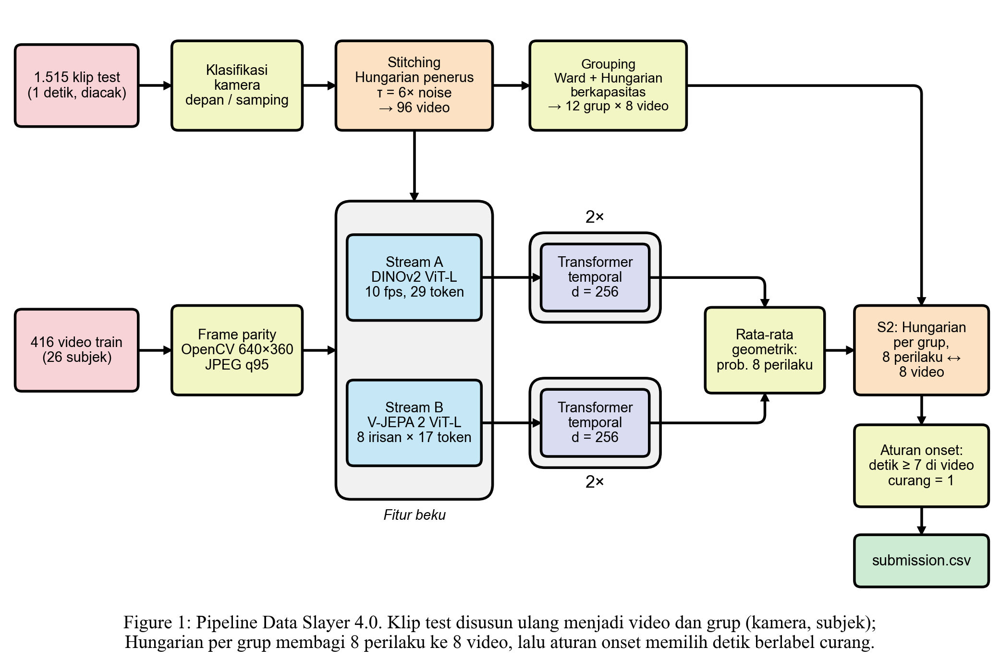
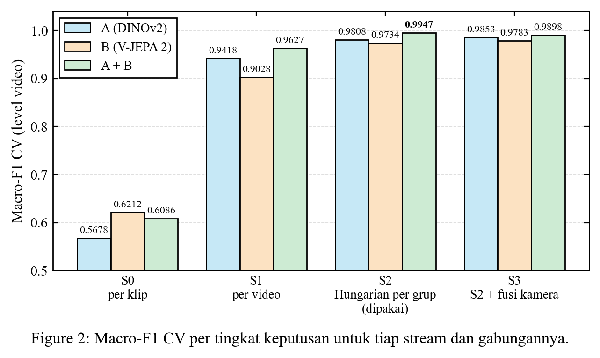
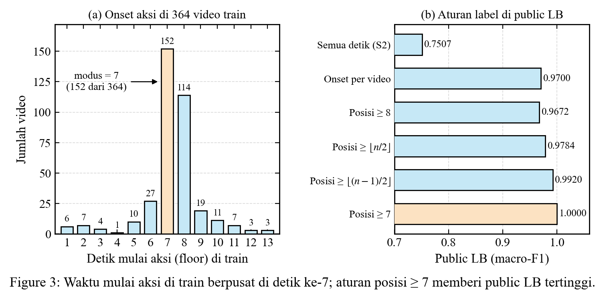

# Data Slayer 4.0: Exam Cheating Detection

Writeup babak penyisihan Data Slayer 4.0 (November 2026), kompetisi komunitas Kaggle untuk mendeteksi kecurangan ujian dari video. Notebook ini mencapai public leaderboard **1.0000000** (macro-F1). Angka itu sebagian berasal dari probing leaderboard: definisi label per detik dipilih setelah enam submission, seperti dijelaskan di bagian [Dari 0.75 ke 1.0](#dari-075-ke-10). Skor private belum keluar saat writeup ini dibuat.

| | |
|---|---|
| Tugas | Klasifikasi biner per klip 1 detik: normal (0) atau curang (1) |
| Metrik | Macro-F1 |
| Data | 416 video train (26 subjek); 1.515 klip test, masing-masing 30 frame |
| Validasi | 5 fold per subjek, dengan simulasi struktur test |
| Skor | CV 0.9947 (level video), public LB 1.0000000 |

## Masalah dan data

Train berisi video utuh: 26 subjek × 2 kamera (depan dan samping) × 8 perilaku. Empat perilaku normal (menulis jawaban, berpikir, melihat sekeliling, mengecek smartwatch) dan empat perilaku curang (melihat ke bawah meja, membaca catatan tersembunyi, mengintip berulang kali, memakai smartwatch). Setiap video berdurasi sekitar 14 sampai 19 detik pada 1280×720. Kamera depan merekam HDR 10-bit HLG pada 30 fps, kamera samping SDR pada 29,97 fps.

Test berisi 1.515 folder `test_seq_XXXXX`, masing-masing 30 JPEG berukuran 640×360. Satu folder sama dengan satu detik video. Dataset lengkap sekitar 6,4 GB dan berisi wajah peserta; lihat [data/README.md](data/README.md).

## Temuan kunci: test adalah video yang dipotong lalu diacak

Klip test adalah potongan 1 detik yang berurutan dari video utuh, lalu urutannya diacak. Jika urutannya bisa dipulihkan, keputusan bisa dibuat per video, yang jauh lebih mudah daripada per detik: hampir setiap video, termasuk video curang, sebagian besar berisi aktivitas menulis biasa, sehingga klasifikasi per klip saja hanya mencapai macro-F1 sekitar 0,6.

### 1. Menyamakan frame train dengan test

Frame train dibuat ulang persis seperti cara panitia membuat test: decode `.MOV` dengan OpenCV, resize ke 640×360 dengan `INTER_AREA`, lalu simpan sebagai JPEG kualitas 95. Tabel kuantisasi JPEG test identik dengan OpenCV q95, dan statistik warna serta ketajaman per kamera cocok antara train dan test.

### 2. Klasifikasi kamera

Regresi logistik pada thumbnail 16×9 dari frame pertama memisahkan kamera depan dan samping dengan akurasi CV 1,0000. Di test hasilnya 742 klip depan dan 773 klip samping.

### 3. Stitching tanpa label

Biaya sambungan antara klip A dan B adalah minimum dari jarak L1 frame terakhir A ke frame pertama B dan biaya ekstrapolasi linear gerakan. Penerus setiap klip dicari secara global dengan algoritma Hungarian, ditambah kolom "tanpa penerus" dengan ambang τ = 6 × median noise di dalam klip. Siklus dipotong di sambungan terlemah, dan rantai yang lebih panjang dari 19 detik dipecah.

Nilai τ dipilih lewat simulasi pada train (8 ulangan × 6 subjek yang klipnya diacak):

| τ (kali median noise) | 3 | 4 | 5 | **6** | 8 |
|---|---|---|---|---|---|
| Video utuh yang pulih (dari 768) | 694 | 747 | 761 | **765** | 753 |

Di semua pengaturan tidak ada satu pun sambungan yang salah. Di test, stitching menghasilkan 97 rantai yang setelah satu penggabungan menjadi 96 video, kira-kira 6 subjek × 16 video.

### 4. Mengelompokkan video per subjek

Setiap rantai diringkas dengan rata-rata token patch DINOv2 (di-center dan dinormalisasi L2), lalu dikelompokkan dengan Ward clustering menjadi 6 grup per kamera. Hungarian berkapasitas memastikan setiap grup berisi tepat 8 video, satu untuk setiap perilaku. Ke-12 grup test lolos pemeriksaan (tepat 8 rantai, masing-masing 12-19 detik).

### 5. Fitur beku dan head temporal

Dua stream fitur dari model beku:

- Stream A: DINOv2 ViT-L/14 reg4 pada 364×644, setiap frame ketiga (10 frame per detik), CLS + grid patch 4×7, jadi 29 token per frame.
- Stream B: V-JEPA 2 ViT-L (`facebook/vjepa2-vitl-fpc64-256`), 16 frame per detik di-crop ke 256², menghasilkan 8 irisan waktu × 17 token.

Head untuk setiap stream memproyeksikan token ke 256 dimensi, menggabungkan versi mentah dan versi yang dikurangi rata-rata videonya, mem-pooling token spasial (dua varian: attention dengan 2 query atau flat), lalu memprosesnya dengan Transformer encoder temporal 2 lapis (d = 256, 4 head). Keluarannya 8 kelas perilaku. Pelatihan 80 epoch dengan AdamW, label smoothing 0,1, token drop, dan crop temporal acak.

### 6. Ensemble dan assignment

Setiap stream dilatih 5 fold × 2 seed × 2 varian head. Probabilitas dirata-rata di dalam stream, lalu kedua stream digabung dengan rata-rata geometrik. Label biner ditentukan dari apakah massa peluang empat kelas curang lebih besar dari empat kelas normal.

Keputusan dibuat bertingkat:

| Tingkat | Cara | Dipakai |
|---|---|---|
| S0 | setiap klip diprediksi sendiri | tidak |
| S1 | prediksi per video hasil stitching | tidak |
| S2 | Hungarian per grup (kamera, subjek): 8 perilaku ↔ 8 video satu-satu, jadi tepat 4 video curang per grup | ya |
| S3 | S2 ditambah fusi kamera depan dan samping lewat sinkronisasi profil aktivitas | tidak |

## Hasil CV

CV meniru test: klip validasi diacak lalu di-stitch ulang, dan klasifikasi kamera di-fit ulang per fold.

| Stream | S0 | S1 | S2 | S3 |
|---|---|---|---|---|
| A (DINOv2) | 0.5678 | 0.9418 | 0.9808 | 0.9853 |
| B (V-JEPA 2) | 0.6212 | 0.9028 | 0.9734 | 0.9783 |
| **A + B** | 0.6086 | 0.9627 | **0.9947** | 0.9898 |

Assignment satu-satu per grup menaikkan skor dari 0,963 ke 0,995. S3 tidak memberi tambahan dengan 26 subjek, dan di test hanya 3 dari 6 pasangan kamera yang saling cocok, jadi S2 yang dipakai. Label test dari S2 dan S3 ternyata identik.

## Dari 0.75 ke 1.0

Submission pertama dengan label S2 (semua detik dalam video curang diberi label 1) hanya mendapat public LB 0.7507271, padahal CV-nya 0.995. Selisih ini menunjukkan bahwa label test dibuat per detik: dalam video curang, hanya detik sejak aksi dimulai sampai akhir yang berlabel 1.

Waktu mulai aksi diukur di train. Untuk setiap video non-menulis, blok waktu berurutan yang paling memisahkan fitur DINOv2 dicari, dan detik mulainya dicatat. Modusnya detik ke-7 (152 dari 364 video) dengan median 7,90 detik, dan waktu mulai hampir tidak berkorelasi dengan durasi video (r = 0,12). Polanya cocok dengan protokol perekaman yang meminta peserta mulai beraksi di sekitar detik ke-7.

Enam aturan diuji di public leaderboard. Pada semua aturan, false positive di public set nol; yang berubah hanya jumlah detik curang yang terlewat:

| Detik yang diberi label curang dalam video curang | Public LB |
|---|---|
| Semua detik (S2) | 0.7507271 |
| Mulai dari onset yang dideteksi per video | 0.9700344 |
| Posisi ≥ 8 | 0.9672316 |
| Posisi ≥ floor(n/2) | 0.9783611 |
| Posisi ≥ floor((n − 1)/2) | 0.9919781 |
| **Posisi ≥ 7 (modus onset di train)** | **1.0000000** |

Aturan final (posisi ≥ 7) berasal dari pengukuran di train, tetapi pemilihannya di antara enam kandidat dibantu oleh skor public. Public set hanya sekitar 30% test (455 klip), dan test sendiri hanya sekitar 6 subjek, jadi skor private bisa berbeda.

## Menjalankan ulang

1. Unduh data ke `data/` (lihat [data/README.md](data/README.md)). Notebook juga bisa membaca zip dataset lewat `DATA_ZIP` (misalnya di Colab).
2. Siapkan GPU CUDA (notebook mewajibkannya) dan Python 3.11 dengan torch 2.11.0 (CUDA 12.8), opencv-python-headless 5.0.0.93, numpy, scipy, scikit-learn, pandas, timm, dan transformers 4.57.1. Notebook memasang timm dan transformers sendiri jika belum ada, dan mengunduh bobot DINOv2 serta V-JEPA 2 saat pertama kali jalan.
3. Jalankan `notebook.ipynb`. Cache frame dan fitur ditulis ke `work/` (sekitar 25 GB). Dengan cache, satu run sekitar 30 menit di RTX 5070 Ti Laptop; dari nol perkiraannya sekitar 2 jam GPU tambahan.

## Isi folder

| Berkas | Keterangan |
|---|---|
| `notebook.ipynb` | Notebook final dengan output. Gambar yang menampilkan wajah peserta (filmstrip train dan perbandingan frame train/test) sudah dihapus dari output. |
| `submission.csv` | Submission final, 1.515 baris (430 curang, 1.085 normal) |
| `data/` | Petunjuk unduh dataset |
