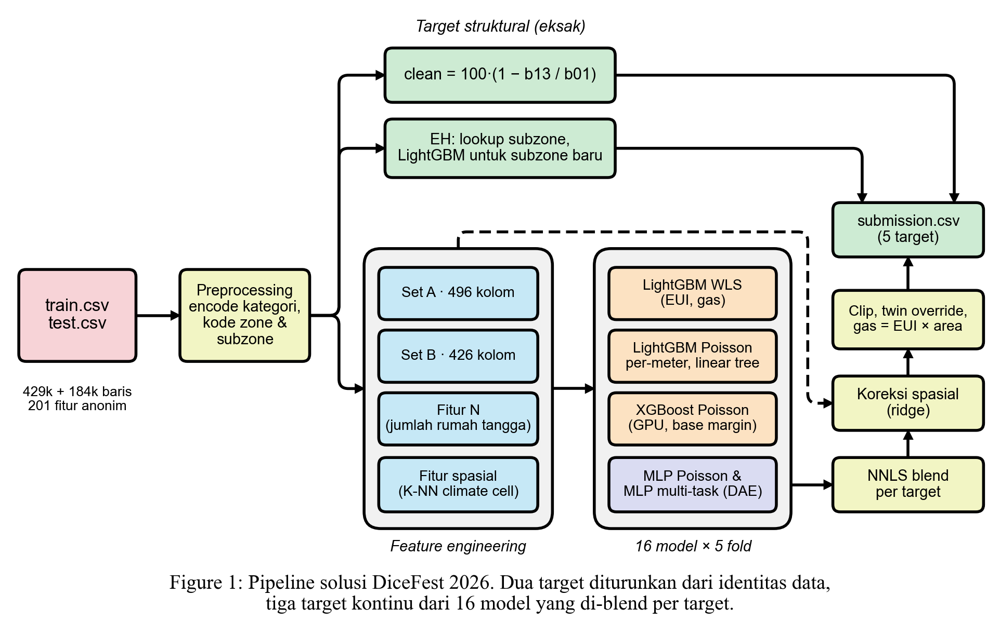
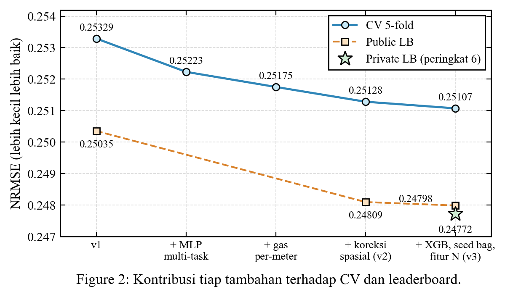
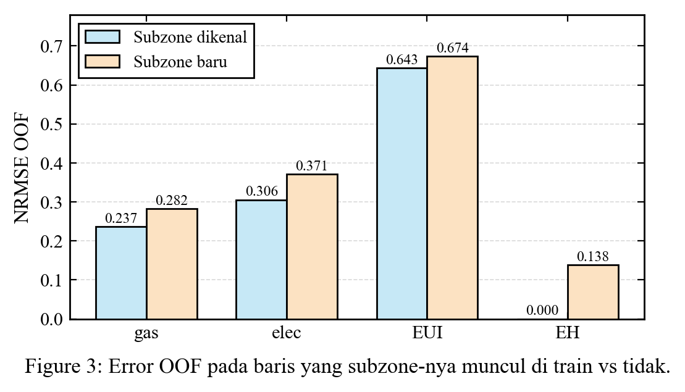

# DiceFest 2026: The Urban Energy Transition Trilemma

Writeup tim **Hbat** untuk lomba Machine Learning DICE FEST 2026 di [Kaggle](https://www.kaggle.com/competitions/dicefest-2026-machine-learning). Solusi akhir menempati **peringkat 6** di private leaderboard (NRMSE 0.24772, public 0.24798) dan membawa tim ke babak presentasi final.

| | |
|---|---|
| Tugas | Regresi multi-output, 5 target konsumsi energi per micro-area perumahan |
| Metrik | Column-wise NRMSE, lebih kecil lebih baik |
| Data | 429.303 baris train, 183.987 baris test, 201 fitur anonim |
| Validasi | KFold acak 5 fold (`random_state=42`) |
| Skor akhir | CV 0.25107, public LB 0.24798, private LB 0.24772 |

## Masalah

Setiap baris adalah satu micro-area perumahan yang berada di dalam sebuah subzone, dan subzone berada di dalam zone. Ada lima target yang harus ditebak sekaligus:

| Kolom | Arti | σ (pembagi metrik) |
|---|---|---|
| `target_macro_gas_kwh` | konsumsi gas tahunan (kWh) | 151.750,04 |
| `target_macro_elec_kwh` | konsumsi listrik tahunan (kWh) | 41.725,37 |
| `target_eui_gas_kwh_per_sqm` | intensitas energi gas per m² | 40,65 |
| `target_clean_building_ratio` | persentase bangunan layak (%) | 12,49 |
| `target_electric_heating_adoption` | adopsi pemanas listrik (%) | 7,18 |

Metriknya adalah rata-rata RMSE tiap target yang dibagi simpangan baku target tersebut:

$$\text{NRMSE} = \frac{1}{5}\sum_{k=1}^{5}\frac{\text{RMSE}_k}{\sigma_k}$$

Nilai σ sama dengan simpangan baku di data train, jadi menebak rata-rata train untuk semua baris menghasilkan skor sekitar 1,0.

## Data

Fitur terbagi ke lima kelompok: `bld_dim` (43 kolom, dimensi bangunan), `bld_era` (15, era pembangunan), `hvac_dist` (10, distribusi sistem pemanas), `env_climate` (6, iklim), dan `socio_demog` (127, sosio-demografi). Dua kolom kategorikal (`bld_dim_18` dengan 4 level dan `socio_demog_016` urban/rural), 11 kolom konstan, dan nilai kosong hanya muncul di `bld_dim_04` serta `bld_dim_07` (695 baris train).

Struktur hierarkinya padat. Train berisi 330 zone dan 153.508 subzone, rata-rata 2,8 baris per subzone. Semua 329 zone di test muncul di train, dan 100.871 dari 110.548 subzone test juga ada di train. Dataset lengkap (sekitar 1,3 GB) tidak disimpan di repo ini; lihat [data/README.md](data/README.md).

## Temuan dari EDA

Tiga identitas eksak ditemukan sebelum membangun model, dan semuanya langsung mengurangi pekerjaan:

1. `gas = EUI × bld_dim_06`. Kolom `bld_dim_06` adalah luas lantai, dan galat relatif maksimum identitas ini 7,75e-16. Model cukup menebak EUI lalu mengalikannya dengan luas.
2. `clean = round(100 · (1 − bld_dim_13 / bld_dim_01), 2)`, dengan `bld_dim_13` jumlah unit di bawah standar dan `bld_dim_01` total unit. Rumus ini cocok di 100% baris train, jadi target ini punya error nol.
3. EH bernilai konstan di dalam satu subzone dan selalu ≤ `rem = 100 − Σ hvac_dist`. Untuk subzone yang sudah muncul di train, nilai EH tinggal disalin.

Pertanyaan berikutnya adalah cara memvalidasi. Panitia menyarankan CV per zone, tetapi data menunjukkan test diambil secara acak dari populasi yang sama. Porsi baris test yang subzone-nya ada di train adalah 0,9186, sementara simulasi split acak memberi 0,9177 ± 0,0006, dan AUC adversarial validation hanya 0,5039. KFold acak dipakai, dan pilihan ini terbukti: estimasi skor test dari CV adalah 0,24746, private LB 0,24772.

Analisis residual juga menentukan loss. Simpangan baku residual log-EUI 0,30 untuk micro-area dengan 2 sampai 4 meter listrik, tetapi hanya 0,13 untuk area besar. RMSE listrik dibagi √(jumlah meter) hampir konstan di sekitar 2.800 kWh. Artinya noise sebanding dengan ukuran area, sehingga EUI dilatih dengan bobot luas (WLS) dan listrik serta gas dimodelkan sebagai Poisson per meter dengan exposure jumlah meter.

## Pendekatan

### Target struktural

`clean` dihitung langsung dari rumus. EH untuk subzone yang dikenal disalin dari train; untuk subzone baru, empat LightGBM di level subzone (tiga cross-entropy pada porsi `rem`, satu MSE) memprediksi proporsi p, lalu EH = `rem · (1 − p)`. Gas dihitung paling akhir sebagai EUI × luas.

### Feature engineering

Semua fitur bebas label, dan agregat grup dihitung dari gabungan fitur train dan test.

- Set A (496 kolom): rasio antar kolom, porsi era dan tipe bangunan, konteks zone dan subzone, rank, z-score.
- Set B (426 kolom): rasio per meter, blok agregat grup, sel iklim.
- Fitur N: jumlah rumah tangga yang dipulihkan dari kisi persentase `hvac_dist` (median N = 128).
- Fitur spasial: residual proxy bersarang dari 20 LightGBM per keluarga target (EUI dan listrik), lalu dirangkum menjadi 17 fitur, misalnya rata-rata K sel iklim terdekat (K = 1 sampai 32) dan K subzone terdekat (K = 1 sampai 128).

### Model

Ada 16 model dasar, masing-masing dilatih 5 fold:

| Keluarga | Target | Catatan |
|---|---|---|
| LightGBM WLS ×5 (Set A) | EUI, gas | sqrt-EUI berbobot luas, gamma, beberapa skema bobot `area^±0.5`; lr 0.05, 127 leaves, 1.700-2.300 ronde |
| LightGBM Poisson per meter, linear tree | gas, listrik | 2 seed, 3.500 ronde untuk gas; listrik Set B 5.500 ronde dengan bobot jumlah meter |
| XGBoost `count:poisson` (GPU) | EUI, gas | `base_margin = log(n_meter)`, depth 10, lr 0.02, 6.000 ronde, prediksi dibatasi EUI maksimum train |
| MLP Poisson | listrik | 512-256-128, embedding zone 8 dimensi, offset log jumlah meter, 3 seed |
| MLP multi-task | EUI, gas, listrik, EH (aux) | pretraining denoising autoencoder (swap noise), body 1024-1024-512, EMA 0.999, 8 run per fold |

### Blending dan post-processing

Per target, prediksi OOF digabung dengan NNLS yang di-cross-fit. Hasilnya dikoreksi dengan ridge kecil (alpha 1e-2) di atas fitur spasial, lalu di-clip. Baris yang punya kembaran persis di train (148 baris OOF, 77 baris test) memakai nilai kembarannya. Terakhir gas dibatasi 1e6, EUI dibatasi 1e6/luas, dan EH di-clip ke [0, `rem`].

## Hasil

| Versi | CV 5-fold | Public LB | Private LB |
|---|---|---|---|
| Prediksi konstan | ≈ 1,0 | | |
| v1 | 0.25329 | 0.25035 | |
| v2 (+ MLP multi-task, gas per meter, koreksi spasial) | 0.25128 | 0.24809 | |
| **v3, final** (+ XGBoost, seed bagging, fitur N) | **0.25107** | **0.24798** | **0.24772** |

Rincian per target untuk versi final (NRMSE OOF):

| Target | Model tunggal terbaik | NNLS | + koreksi spasial | Final |
|---|---|---|---|---|
| gas | 0.24670 | 0.24413 | 0.24332 | 0.24329 |
| listrik | 0.31758 | 0.31535 | 0.31503 | 0.31496 |
| EUI | 0.65285 | 0.64832 | 0.64721 | 0.64715 |
| clean | | | | 0 |
| EH | | | | 0.04992 |

EUI adalah target tersulit: NRMSE-nya sekitar 0,65 bahkan setelah blending, sementara clean dan EH hampir nol karena identitas di atas. Gambar 3 menunjukkan selisih error antara subzone yang dikenal dan subzone baru. Karena 91,9% baris test berasal dari subzone yang dikenal, skor test lebih dekat ke batang biru.

Beberapa eksperimen kecil yang ikut menentukan desain (rata-rata fold 0 dan 1, satu LightGBM):

| Eksperimen | NRMSE |
|---|---|
| EUI, loss L2 pada log | 0.6845 |
| EUI, WLS berbobot luas | 0.6786 |
| EUI, WLS + Set A | 0.6632 |
| Listrik, loss log | 0.3314 |
| Listrik, loss sqrt | 0.3283 |
| Listrik, Poisson | 0.3230 |
| Listrik, Poisson per meter | 0.3218 |
| Skema CV: KFold acak vs GroupKFold per zone (model EUI cepat) | 0.68962 vs 0.70811 |

## Yang tidak membantu

Target encoding bersarang, refit di 100% data, stacking GBDT tahap dua, pseudo-labeling, fitur N untuk EUI, dan 17 varian model EH semuanya memberi perubahan di bawah ±0,0001. Residual tetangga dalam subzone yang sama sempat terlihat memperbaiki CV sebesar 0,0011, tetapi efek itu hilang setelah dihitung secara bersarang, jadi tidak dipakai. CatBoost GPU juga ditolak karena hasilnya tidak deterministik.

## Menjalankan ulang

1. Unduh data ke folder `data/` (lihat [data/README.md](data/README.md)). Notebook otomatis mencari `datasets/`, `data/`, atau `/kaggle/input/**`.
2. Siapkan Python 3.12 dengan numpy 2.4.6, pandas 2.3.3, scikit-learn 1.6.1, scipy 1.17.1, lightgbm 4.6.0, xgboost 3.2.0, torch 2.11.0 (CUDA 12.8), dan matplotlib 3.10.9.
3. Jalankan `notebook.ipynb` dari atas. Prediksi tiap model disimpan sebagai cache di `artifacts/`; cache ini tidak ikut di repo (sekitar 285 MB), jadi run pertama melatih ulang semuanya. Di laptop RTX 5070 Ti dengan RAM 32 GB prosesnya sekitar 4,5 jam. Set `DICE_FAST_DEV_RUN=1` untuk uji cepat, atau `DICE_RECOMPUTE=1` untuk memaksa latih ulang.

XGBoost dan MLP berjalan di CUDA. Di CPU notebook tetap jalan, tetapi hasilnya tidak identik bit per bit dengan `submission.csv`.

## Isi folder

| Berkas | Keterangan |
|---|---|
| `notebook.ipynb` | Notebook final (v3) beserta output eksekusinya |
| `submission.csv` | Submission final, 183.987 baris (MD5 `51fa8cef39f557852dec3190e0195f52`) |
| `data/` | Petunjuk unduh dataset |
