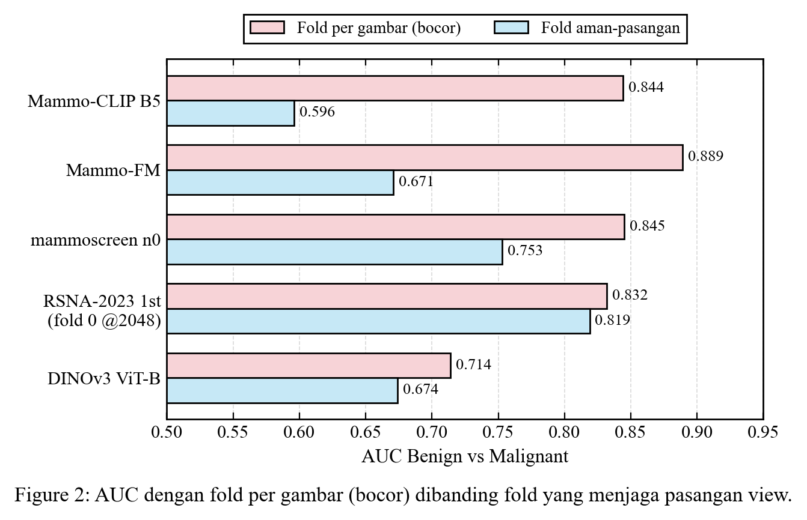
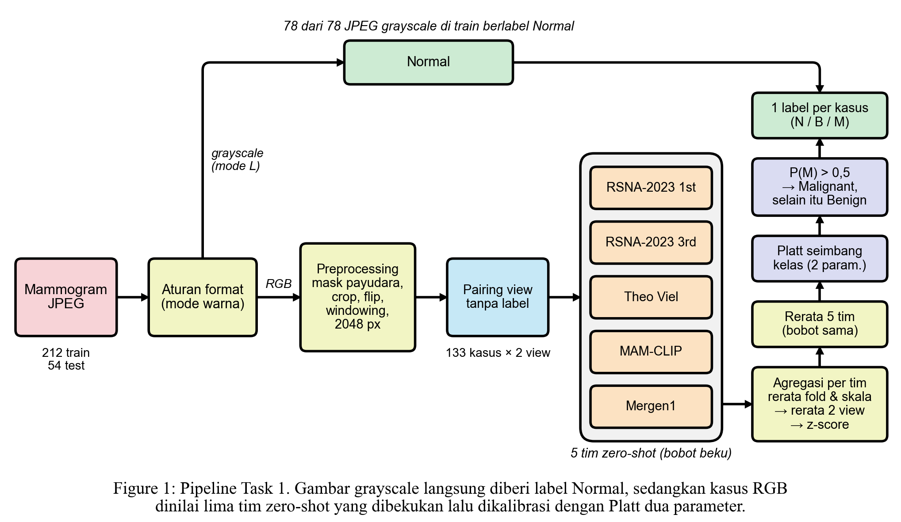
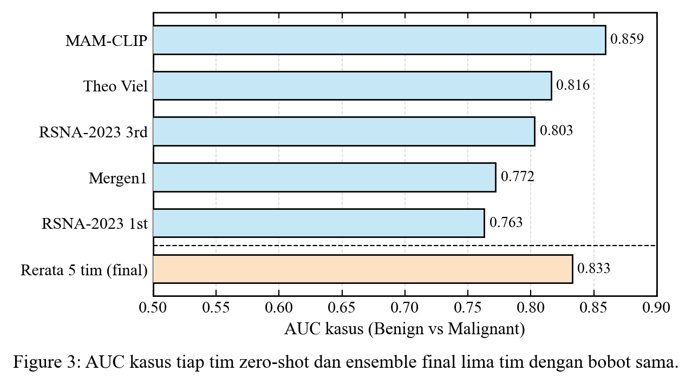
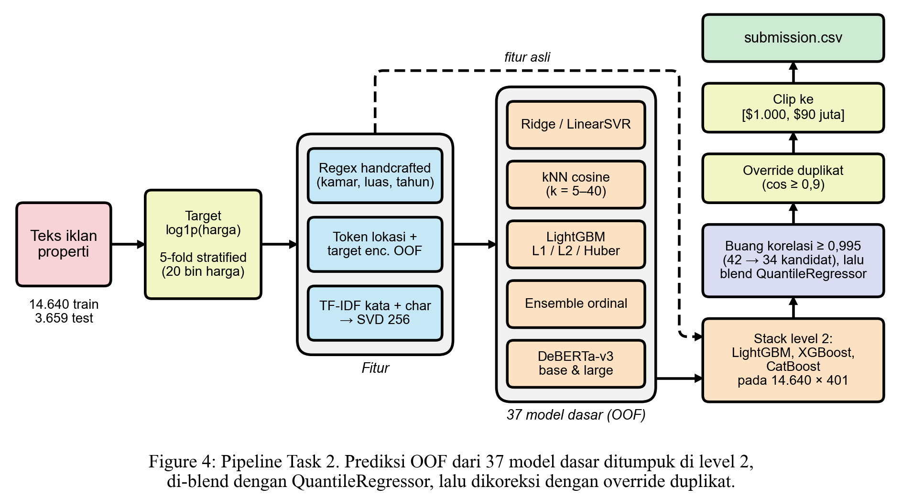
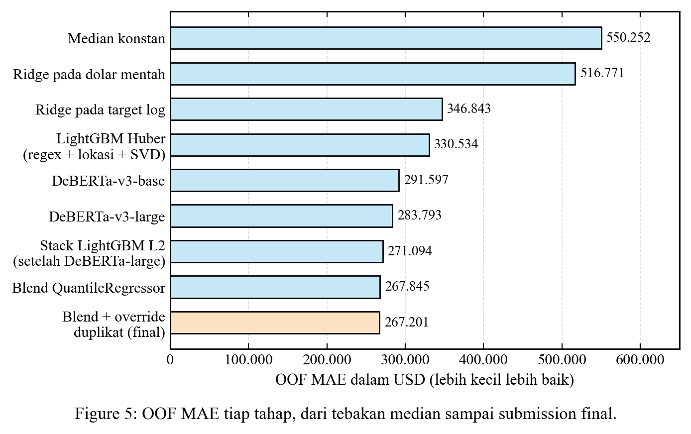

# Hology 2026: HoloMine

Writeup tim **nasi bungkus** untuk dua soal data mining HoloMine di Hology (September 2026). Kedua soal sangat berbeda: Task 1 adalah klasifikasi mammogram dengan data yang sangat sedikit, Task 2 adalah regresi harga properti dari teks iklan.

| | Task 1: Mammogram | Task 2: Harga properti |
|---|---|---|
| Tugas | Klasifikasi Normal / Benign / Malignant | Regresi `listPrice` (USD) dari teks iklan |
| Metrik | Macro-F1 | MAE dalam dolar |
| Data | 212 gambar train, 54 gambar test | 14.640 iklan train, 3.659 test |
| Skor | CV macro-F1 0.832, public LB 0.75 | OOF MAE 267.201 |
| Folder | [`task-1-mammogram/`](task-1-mammogram) | [`task-2-property-price/`](task-2-property-price) |

Leaderboard publik dihitung dari sekitar 30% test dan peringkat ditentukan oleh 70% sisanya. Peringkat akhir kedua task tidak tercatat.

---

## Task 1: Klasifikasi mammogram

### Masalah dan data

Setiap gambar mammogram harus diberi label Normal, Benign, atau Malignant. Menurut protokol yang kami tulis selama lomba, datanya berasal dari MDCMI-BC (mammografi CR dari Yaman) dengan label dari kesan BI-RADS radiolog tanpa biopsi: Benign = BI-RADS 2-3, Malignant = BI-RADS 4-5.

Train hanya berisi 212 JPEG (80 Normal, 52 Benign, 80 Malignant) berukuran 3540×4740, dan test 54 gambar. Gambar-gambar ini sebenarnya berpasangan: 133 kasus × 2 view (CC dan MLO/ML), dengan 106 kasus di train yang berasal dari 92 perempuan. Jadi data efektifnya 66 kasus abnormal untuk membedakan Benign dari Malignant.

Ada kebocoran format yang jelas. Ke-78 JPEG grayscale (mode `L`) di train semuanya Normal, sementara JPEG RGB berisi 52 Benign, 80 Malignant, dan 2 Normal; tabel kuantisasi JPEG keduanya juga berbeda. Test berisi 20 gambar grayscale dan 34 RGB. Akibatnya kelas Normal hampir pasti benar, dan skor sebenarnya ditentukan oleh pemisahan Benign vs Malignant pada 17 kasus RGB di test.

### Jebakan validasi

Skor awal encoder mammografi terlihat sangat bagus (AUC Benign vs Malignant sampai 0,89) karena fold dibuat per gambar. Dua view dari kasus yang sama jatuh ke fold berbeda, dan model hanya menghafal view pasangannya. Uji kNN k=1 memperlihatkannya: AUC Mammo-CLIP B5 0,841 dengan semua gambar, turun ke 0,628 ketika gambar pasangannya dihapus, tetapi tetap 0,840 ketika yang dihapus gambar acak.

| Encoder | Fold per gambar (bocor) | Fold aman-pasangan |
|---|---|---|
| Mammo-CLIP B5 | 0.844 | 0.596 |
| Mammo-FM | 0.889 | 0.671 |
| mammoscreen n0 | 0.845 | 0.753 |
| RSNA-2023 1st, fold 0 @2048 | 0.832 | 0.819 |
| DINOv3 ViT-B | 0.714 | 0.674 |

Pasangan view tidak diberikan, jadi kami merekonstruksinya tanpa label: OCR teks view, kemiripan embedding dari 9 encoder, lateralitas, dan ukuran payudara, lalu maximum-weight perfect matching di dalam tiap blok (split, mode warna). Hasilnya diaudit dua kali: dibangun ulang dengan label diacak menghasilkan berkas yang identik byte per byte, dan 67 dari 67 pasangan RGB di train berlabel sama (peluang acak 0,51). Validasi akhir memakai 5 × 5-fold yang dikelompokkan per perempuan.

### Pendekatan

Dengan hanya 66 kasus abnormal, melatih model sendiri kalah dari model mammografi publik yang dibekukan. Tidak ada bobot yang dilatih di data lomba, kecuali kalibrasi dua parameter di akhir.

1. Aturan format: gambar grayscale diberi label Normal.
2. Preprocessing: mask payudara (Otsu pada gambar yang diperkecil 8 kali, estimasi level latar, komponen terbesar, operasi morfologi), piksel di luar mask dinolkan untuk menghapus teks yang tercetak, crop, flip supaya dinding dada di kiri, windowing ke persentil 99,5, lalu disimpan dengan sisi panjang 2048.
3. Lima "tim" scorer zero-shot, semuanya model publik:

| Tim | Model | Input |
|---|---|---|
| RSNA-2023 1st | ConvNeXt-small, 4 fold | letterbox 2048×1024, 1792×896, 1536×768; TTA flip 4 arah |
| RSNA-2023 3rd | EffNetV2-S, ConvNeXt-nano/tiny, dua di antaranya dengan BiLSTM per kasus | 2048×1280 dan 1536×960; TTA hflip |
| Theo Viel | EffNetV2-M ×2, ECA-NFNet-L2 ×2, ECA-NFNet-L1 (GeM) | 1536×1024 |
| MAM-CLIP | ConvNeXt-small dan tiny dengan head BI-RADS | 1024×768; skor = logit P(BI-RADS 4 atau 5) |
| Mergen1 (TEKNOFEST 2023) | EffNet-B0, 3 kelas BI-RADS | 500×250 |

4. Agregasi: logit tiap keluarga dirata-rata antar fold dan skala, lalu antar dua view dalam satu kasus, lalu di-z-score terhadap semua kasus RGB di train dan test (tanpa label). Skor tim adalah rata-rata keluarganya, dan skor akhir rata-rata kelima tim dengan bobot sama.
5. Keputusan: Platt scaling dua parameter yang seimbang kelas, di-fit di dalam fold. P(Malignant) > 0,5 berarti Malignant, selain itu Benign. Satu label per kasus.

### Hasil

| Versi | Isi | AUC kasus (B vs M) | CV macro-F1 3 kelas | Public LB |
|---|---|---|---|---|
| v1 | RSNA-1st saja | 0.76 | 0.80 | 0.65714 |
| v2 | 8 keluarga | 0.813 | | 0.65714 |
| v3 | 4 tim | 0.83 | 0.82 | sama dengan v1 |
| **v4 (final)** | **5 tim** | **0.833** | **0.832 ± 0.004** | **0.75** |

AUC per tim: MAM-CLIP 0,859, Theo 0,816, RSNA-3rd 0,803, Mergen1 0,772, RSNA-1st 0,763. Model yang dilatih pada label BI-RADS (MAM-CLIP) paling cocok, masuk akal karena label lomba juga berasal dari BI-RADS. Delapan tim lain dibuang karena AUC-nya 0,63-0,69 (RSNA 2nd, 4th, 5th, 6th, NYU GMIC, dan lainnya); memasukkan ke-13 tim dengan bobot sama menurunkan AUC ke 0,78. Pemimpin public LB saat itu berada di 0.88.

Confusion matrix OOF (baris = label asli N/B/M): [[78, 2, 0], [0, 46, 6], [0, 26, 54]]. Sebagian besar error adalah Malignant yang terbaca Benign. Pembacaan visual buta atas 66 panel kasus menunjukkan 9-10 dari 40 kasus Malignant memang terlihat jinak bagi semua pembaca, sehingga batas atas realistisnya sekitar macro-F1 0,90.

Yang tidak membantu: fine-tune RSNA-1st di data lomba (AUC kasus 0,77 vs 0,76 zero-shot), head kernel ridge di atas fitur RSNA, stacking LR (0,824 vs 0,821), aturan pencocokan prior (0,812), threshold yang dituning (−0,03 out-of-bag), dan data eksternal MammosighTR (CV 0,823). Resolusi input juga tidak berpengaruh: 2048, 1536, dan multiskala semuanya di kisaran 0,751-0,764.

---

## Task 2: Prediksi harga properti dari teks

### Masalah dan data

Setiap baris berisi satu teks iklan properti bebas (median 882 karakter atau 137 kata) dan target `listPrice` dalam USD. Harga berkisar dari $1 sampai $80 juta dengan median $499.900. Sebanyak 2.702 teks berisi token `[Redacted Entity]`. Menebak median untuk semua baris memberi MAE 550.252. Baris di atas $2 juta hanya 5,8% data, tetapi menyumbang sekitar 47% error, jadi ekor atas distribusi sangat menentukan skor.

### Pendekatan

1. Target `log1p(listPrice)`, 5-fold StratifiedKFold pada 20 bin kuantil harga; split yang sama dipakai di semua model.
2. Fitur:
   - Regex untuk jumlah kamar tidur dan mandi, luas bangunan, luas tanah (acre), tahun, sekitar 28 keluarga kata kunci, dan panjang teks.
   - Token lokasi (pola preposisi, "City, ST", nama negara bagian, kata Title-Case) dengan target encoding out-of-fold yang dihaluskan.
   - TF-IDF kata 1-2 dan karakter 3-5 (masing-masing 300 ribu fitur), lalu SVD 256 komponen.
3. 37 model dasar: Ridge dan LinearSVR pada target log, kNN cosine TF-IDF (k = 5, 10, 20, 40), LightGBM dengan loss L1/L2/Huber dan beberapa skema bobot harga, ensemble ordinal (29 regresi logistik ambang yang digabung menjadi kurva survival), serta DeBERTa-v3-base dan DeBERTa-v3-large dengan loss L1 pada log harga terstandardisasi.
4. Stacking level 2 dengan lima model (tiga varian LightGBM, XGBoost, CatBoost) pada matriks 14.640 × 401: fitur asli, 37 prediksi OOF, fitur kNN, dan statistik sebaran prediksi.
5. Blending: kandidat dengan korelasi ≥ 0,995 dibuang (42 → 34), lalu bobot dicari dengan QuantileRegressor median yang di-nest. Cara ini mengalahkan power mean dan seleksi greedy Caruana.
6. Override duplikat: untuk baris test dengan tetangga train ber-cosine ≥ 0,9 (56 baris), harga tetangganya disalin. Prediksi akhir di-clip ke [$1.000, $90 juta].

### Hasil

| Tahap | OOF MAE |
|---|---|
| Median konstan | 550.252 |
| Ridge pada dolar mentah | 516.771 |
| Ridge pada target log | 346.843 |
| LightGBM Huber (fitur regex + lokasi + SVD) | 330.534 |
| DeBERTa-v3-base | 291.597 |
| DeBERTa-v3-large | 283.793 |
| Stack LightGBM L2 (setelah DeBERTa-large) | 271.094 |
| Blend QuantileRegressor | 267.845 |
| **Blend + override duplikat (final)** | **267.201** |

Standard error MAE OOF sekitar 9.359, jadi selisih di bawah angka itu sebaiknya tidak dibaca berlebihan. Target log menyumbang sekitar 170 ribu, target encoding lokasi sekitar 30 ribu, dan Huber mengalahkan L1 di ruang log sekitar 15 ribu. Transformer adalah lompatan tunggal terbesar, dan prediksi DeBERTa mendominasi gain di stacker. Override duplikat hanya memberi 692, di bawah standard error.

Yang tidak membantu: pembobotan penuh dengan harga (w = y) memperburuk MAE 42 ribu, dan semua kalibrasi akhir (affine, isotonic, piecewise) memperburuk skor saat diuji secara nested. Bobot blend sama rata memberi 312-316 ribu, jauh di atas bobot QuantileRegressor.

Error masih terkonsentrasi di properti mahal. Properti di atas $5 juta punya MAE 5,30 juta per baris dan menyumbang 29,8% total error, sedangkan properti di bawah $200 ribu hanya 4,5%.

---

## Menjalankan ulang

Task 1 (`task-1-mammogram/notebook.ipynb`, sudah dieksekusi beserta outputnya):

- Data gambar sekitar 637 MB dan tidak disimpan di repo; lihat [`task-1-mammogram/data/README.md`](task-1-mammogram/data/README.md).
- Notebook membaca cache skor dan fitur (`nb_cache/`, sekitar 290 MB) serta `artifacts/pairs.csv` dan `artifacts/folds.csv` hasil rekonstruksi pasangan. Cache ini tidak ikut di repo. Tanpa cache, notebook mengunduh bobot model publik lewat Kaggle CLI dan Google Drive (lebih dari 15 GB) dan butuh GPU CUDA.
- Paket: torch, timm, torchvision, scikit-learn, opencv, pandas, Pillow, matplotlib, plus networkx dan efficientnet_pytorch untuk jalur cadangan.

Task 2 (`task-2-property-price/notebook.ipynb`):

- Data sudah ada di `data/`.
- Notebook ini versi ringkas dari pipeline riset: stack-nya hanya LightGBM dan secara default memuat prediksi DeBERTa-v3-base yang sudah disimpan (`run_transformer=False`). Notebook belum pernah dieksekusi dan tidak akan menghasilkan `submission.csv` yang persis sama.
- `submission.csv` dibuat oleh skrip riset (stack lima model, 42 kandidat, termasuk DeBERTa-v3-large) dengan OOF MAE 267.201.
- Paket: numpy, pandas, scipy, scikit-learn, lightgbm; torch dan transformers jika `run_transformer=True`.

## Isi folder

| Berkas | Keterangan |
|---|---|
| `task-1-mammogram/notebook.ipynb` | Notebook final Task 1 (v4) dengan output |
| `task-1-mammogram/submission.csv` | Submission final v4, 54 baris |
| `task-1-mammogram/data/` | Petunjuk unduh data |
| `task-2-property-price/notebook.ipynb` | Notebook Task 2 (versi ringkas, tanpa output) |
| `task-2-property-price/submission.csv` | Submission final, 3.659 baris |
| `task-2-property-price/data/` | `train.csv`, `test.csv`, `sample_submission.csv` |
