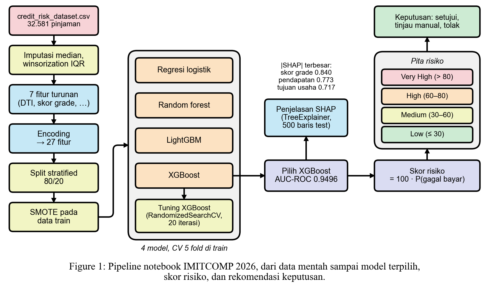
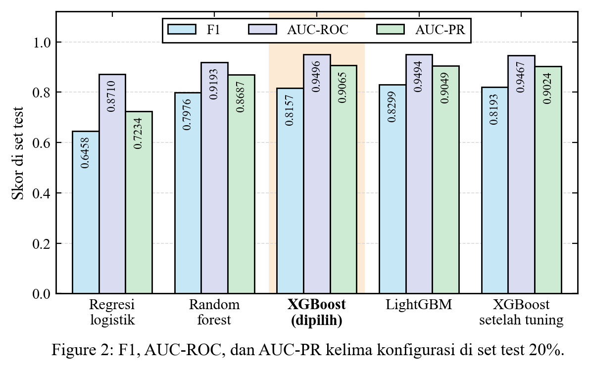
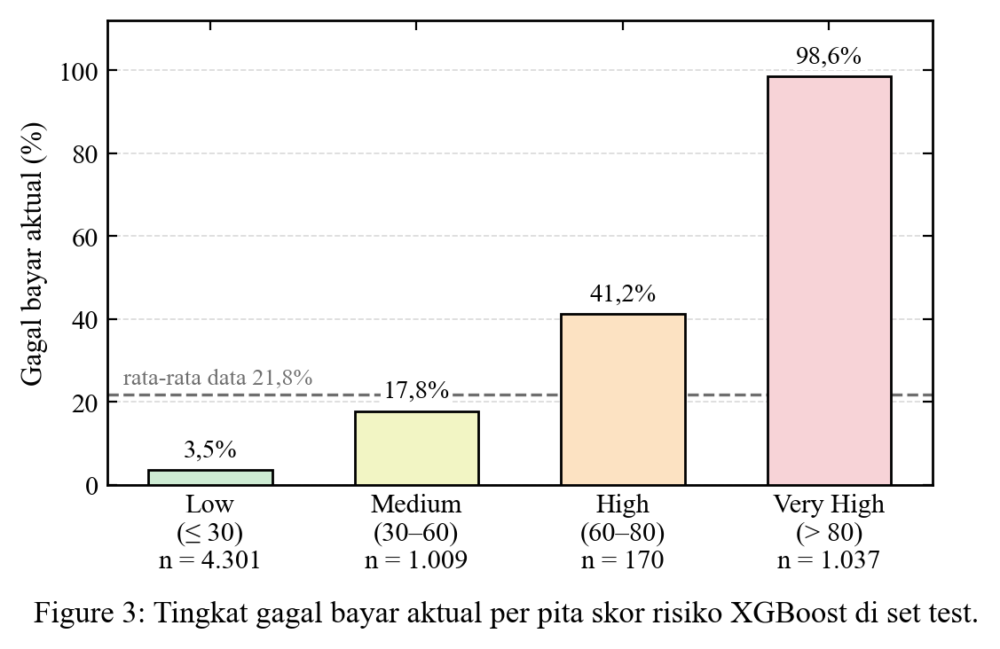

# IMITCOMP 2026: Digital Lending Risk Intelligence

Writeup notebook untuk IMITCOMP 2026 bertema "Innovating The Future of Digital Finance" (Mei 2026). Berbeda dengan lomba lain di repo ini, IMITCOMP dinilai juri dari notebook, bukan dari leaderboard. Notebook ini membangun model prediksi gagal bayar untuk pinjaman peer-to-peer, menjelaskannya dengan SHAP, lalu menerjemahkan probabilitas menjadi skor risiko dan rekomendasi kebijakan.

| | |
|---|---|
| Tugas | Klasifikasi biner `loan_status` (1 = gagal bayar) |
| Metrik | AUC-ROC (utama), F1, AUC-PR |
| Data | 32.581 pinjaman, 12 kolom |
| Validasi | Split stratified 80/20, CV 5 fold di data train |
| Hasil | XGBoost, AUC-ROC test 0.9496 |

## Data

Dataset yang dipakai adalah "Credit Risk Dataset" publik dari Kaggle (laotse), bukan data P2P Indonesia; notebook menyebut keterbatasan ini secara eksplisit. Kolomnya berisi profil peminjam (umur, pendapatan, status kepemilikan rumah, lama bekerja, panjang riwayat kredit, riwayat gagal bayar) dan profil pinjaman (tujuan, grade, jumlah, bunga, rasio pinjaman terhadap pendapatan).

Sebanyak 21,8% pinjaman gagal bayar (rasio 3,6 : 1). Nilai kosong ada di `loan_int_rate` (9,6%) dan `person_emp_length` (2,7%), dan ada nilai yang tidak masuk akal seperti umur 144 tahun dan lama bekerja 123 tahun.

Tingkat gagal bayar naik tajam mengikuti grade pinjaman:

| Grade | A | B | C | D | E | F | G |
|---|---|---|---|---|---|---|---|
| Gagal bayar | 10,0% | 16,3% | 20,7% | 59,0% | 64,4% | 70,5% | 98,4% |

Penyewa rumah (31,6%) jauh lebih sering gagal bayar daripada pemilik rumah (7,5%), dan peminjam dengan riwayat gagal bayar sebelumnya 37,8% dibanding 18,4%.

## Pendekatan

1. Imputasi median (yang ternyata tidak berjalan; lihat [catatan setelah lomba](#catatan-setelah-lomba)), lalu winsorization IQR untuk umur, pendapatan, lama bekerja, dan jumlah pinjaman.
2. Tujuh fitur turunan: `debt_to_income`, `payment_burden`, `income_per_age`, `credit_age_ratio`, skor grade (A = 1 sampai G = 7), `high_risk_flag` (bunga > 15% dan rasio pinjaman > 0,3), dan `employment_stability`. Hasilnya 27 fitur setelah encoding.
3. Split stratified 80/20, SMOTE pada data train, dan StandardScaler khusus untuk regresi logistik.
4. Empat model: regresi logistik, random forest, XGBoost, LightGBM. XGBoost juga dituning dengan RandomizedSearchCV (20 iterasi).
5. Interpretasi dengan SHAP TreeExplainer pada 500 baris test.
6. Skor risiko = 100 × P(gagal bayar), dibagi menjadi Low (≤ 30), Medium (≤ 60), High (≤ 80), dan Very High (> 80), lalu dipetakan ke keputusan setujui, tinjau manual, atau tolak.

## Hasil

| Model | Presisi | Recall | F1 | AUC-ROC | AUC-PR |
|---|---|---|---|---|---|
| Regresi logistik | 0.7261 | 0.5816 | 0.6458 | 0.8710 | 0.7234 |
| Random forest | 0.9084 | 0.7110 | 0.7976 | 0.9193 | 0.8687 |
| **XGBoost (dipilih)** | 0.8287 | 0.8031 | 0.8157 | **0.9496** | **0.9065** |
| LightGBM | 0.9629 | 0.7293 | 0.8299 | 0.9494 | 0.9049 |
| XGBoost setelah tuning | 0.8577 | 0.7841 | 0.8193 | 0.9467 | 0.9024 |

XGBoost dipilih karena AUC-ROC tertinggi dan recall jauh lebih baik daripada LightGBM. Di set test, XGBoost menghasilkan 4.859 true negative, 236 false positive, 280 false negative, dan 1.142 true positive. Tuning tidak mengalahkan konfigurasi bawaan.

Skor risiko terbukti terurut dengan baik di set test:

| Pita risiko | Jumlah pinjaman | Gagal bayar aktual |
|---|---|---|
| Low (≤ 30) | 4.301 | 3,5% |
| Medium (30-60) | 1.009 | 17,8% |
| High (60-80) | 170 | 41,2% |
| Very High (> 80) | 1.037 | 98,6% |

Fitur dengan rata-rata |SHAP| terbesar adalah skor grade pinjaman (0,840), pendapatan (0,773), tujuan pinjaman usaha (0,717), dan status kepemilikan rumah.

## Catatan setelah lomba

Saat notebook ini ditinjau ulang, ada beberapa kekurangan yang perlu dicatat:

- Imputasi median tidak berjalan. Pola `df[col].fillna(..., inplace=True)` tidak berpengaruh di pandas 3 karena copy-on-write, sehingga nilai bunga dan lama bekerja yang kosong akhirnya diisi 0 oleh `fillna(0)` di langkah encoding. Dengan imputasi median yang benar (diuji di pandas 2.3.3), AUC XGBoost menjadi 0,9466 dan LightGBM 0,9481, jadi kesimpulannya tidak berubah banyak.
- SMOTE diterapkan sebelum cross-validation, sehingga AUC CV (sekitar 0,985) terlalu optimis dibanding AUC test (sekitar 0,95). XGBoost juga memakai `scale_pos_weight` di atas data yang sudah diseimbangkan SMOTE.
- Winsorization umur pada 40,5 tahun memotong nilai umur yang sebenarnya wajar.
- Tabel validasi pita risiko di notebook tercetak kosong karena kesalahan reindex, sehingga pemeriksaan monotonisitas di sana tidak berarti. Angka pita risiko di atas dihitung ulang dari prediksi XGBoost yang sama.
- Beberapa klaim di markdown notebook tidak cocok dengan output, misalnya suku bunga disebut prediktor teratas di semua model (padahal tidak masuk 15 besar SHAP) dan grade A disebut hampir 0% gagal bayar (sebenarnya 10%).

## Menjalankan ulang

1. Data sudah ada di `data/credit_risk_dataset.csv`.
2. Pasang pandas, numpy, scikit-learn, xgboost, lightgbm, imbalanced-learn, shap, matplotlib, dan seaborn. Notebook dijalankan dengan pandas 3.0.1, scikit-learn 1.8.0, xgboost 3.2.0, lightgbm 4.6.0, shap 0.51.0, dan imbalanced-learn 0.14.1. Dengan pandas 2.x, imputasi berjalan sehingga angkanya sedikit berbeda.
3. Jalankan `notebook.ipynb` dari atas.

## Isi folder

| Berkas | Keterangan |
|---|---|
| `notebook.ipynb` | Notebook lomba dengan output dan 22 grafik |
| `data/credit_risk_dataset.csv` | Dataset (32.581 baris) |

Folder ini tidak punya `submission.csv` karena IMITCOMP dinilai dari notebook, bukan dari prediksi test.
