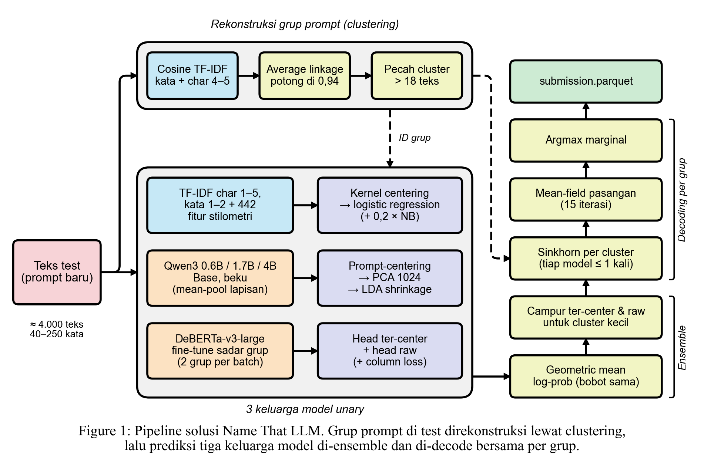
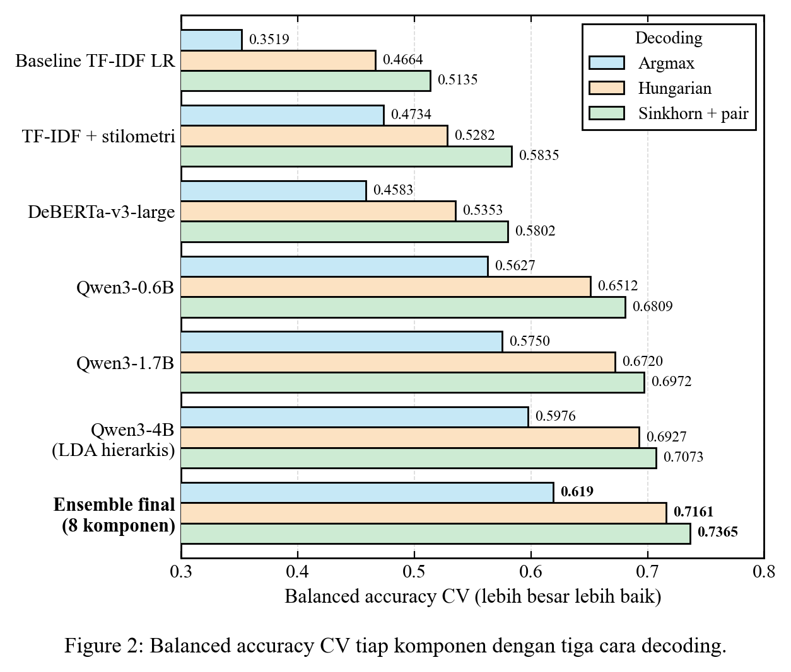
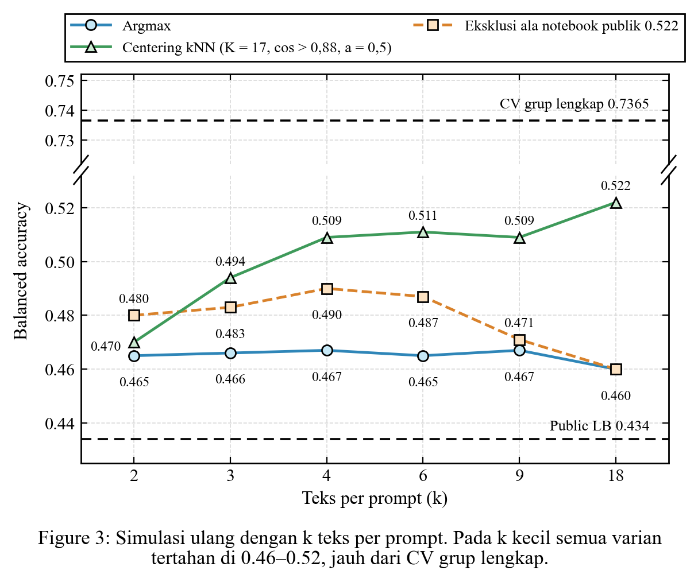

# Name That LLM

Writeup untuk kompetisi kode Kaggle **Name That LLM** (Oktober 2026): menebak model bahasa mana yang menulis sebuah potongan teks, dari 18 kandidat. Solusi ini mencapai balanced accuracy 0.7365 di CV, tetapi public leaderboard-nya hanya 0.434. Sebagian besar writeup ini membahas kenapa angka CV setinggi itu tidak terbawa ke leaderboard.

| | |
|---|---|
| Tugas | Klasifikasi 18 kelas, atribusi teks ke LLM penulisnya |
| Metrik | Balanced accuracy (rata-rata recall per kelas) |
| Data | 2.699 teks train dari 150 prompt; test tersembunyi sekitar 4.000 teks |
| Validasi | GroupKFold 5 fold per `prompt_id` |
| Skor | CV 0.7365, public LB 0.434 |
| Batasan | Notebook saja, tanpa internet, maksimal 9 jam di GPU T4 |

## Masalah

Setiap teks berisi 40 sampai 250 kata dan ditulis oleh salah satu dari 18 model: lima Claude, empat Gemini, lima GPT, dua GLM, Kimi K3, dan Qwen 3.8 Max. Test dibangun dari prompt yang tidak pernah muncul di train, dan sebaran kelasnya tidak seimbang serta berbeda antara public dan private leaderboard. Submission berupa `submission.parquet` dengan kolom `id` dan `model`.

## Data

Train berisi 150 prompt. Untuk 149 prompt, ke-18 model menjawab prompt yang sama, dan prompt p002 hanya punya 17 jawaban. Kelasnya seimbang sempurna (150 teks per kelas, kecuali `claude-fable-5` dengan 149). `test.csv` di Kaggle hanya berisi 3 contoh; test sebenarnya baru tersedia saat notebook dijalankan ulang oleh Kaggle.

Panjang teks tidak bisa dipakai sebagai sinyal. Simpangan baku jumlah kata di dalam satu prompt (57,8) hampir sama dengan simpangan baku keseluruhan (58,3), dan rata-rata per model hanya berkisar 100,7 sampai 123,6 kata. Sinyal yang jauh lebih kuat ada di tipografi:

| Kelompok model | Teks berisi em dash | Teks berisi kutip lengkung ’ | Teks berisi kutip lengkung “ |
|---|---|---|---|
| Claude ×5, GLM ×2 | 63-83% | 0% | 0% |
| Gemini ×4 | 0-1% | 6-31% | 0-2% |
| GPT ×5 | 9-37% | 42-53% | 7-15% |
| Kimi K3 | 52% | 32% | 9% |
| Qwen 3.8 Max | 3% | 29% | 1% |

Pola ini membuat pembedaan antar-vendor relatif mudah. Kesulitan sebenarnya ada di dalam satu vendor, misalnya membedakan `glm-5.3` dari `glm-5.3-flash` atau lima varian GPT.

## Ide utama: memanfaatkan struktur prompt × model

Di train, satu prompt dijawab oleh semua model, masing-masing sekali. Kalau test punya struktur yang sama, ada dua hal yang bisa dimanfaatkan:

1. Prompt-centering. Isi teks sangat dipengaruhi prompt-nya. Dengan mengurangi rata-rata fitur semua teks dari prompt yang sama, yang tersisa adalah gaya model. Di train pengelompokan memakai `prompt_id`; di test grupnya harus ditemukan ulang lewat clustering.
2. Decoding per grup. Dalam satu grup, setiap model muncul paling banyak sekali, sehingga prediksi bisa diperlakukan sebagai masalah assignment, bukan argmax per teks.

### Rekonstruksi grup prompt di test

Kemiripan antar teks dihitung sebagai 0,5 × cosine TF-IDF kata (tanpa stop word, stem 6 huruf) + 0,5 × cosine TF-IDF karakter 4-5. Agglomerative clustering average linkage dipotong pada 0,94, lalu setiap cluster yang lebih besar dari 18 dipecah. Langkah pemecahan ini penting: di train, akurasinya naik dari 0,4212 menjadi 0,4667 untuk baseline TF-IDF, dan porsi grup yang terbentuk persis naik dari 0,39 ke 0,96 (ARI 0,992).

### Model unary

Ada tiga keluarga model, masing-masing dengan head yang di-center per prompt dan kembaran "raw" tanpa centering:

- TF-IDF dan stilometri (CPU, sekitar 3 menit). Fitur karakter 1-5 case-sensitive (300 ribu fitur), kata 1-2 dengan token tanda baca, dan 442 fitur stilometri. Centering dilakukan secara eksak di ruang kernel, Kc = K − GK − KG + GKG, lalu logistic regression (C = 10). Ditambah 0,2 × Multinomial Naive Bayes.
- LM decoder beku: Qwen3-4B, 1.7B, dan 0.6B Base. Token `<|endoftext|>` ditaruh di depan sebagai attention sink, hidden state lapisan genap di-mean-pool tanpa token sink, lalu prompt-centering → StandardScaler → PCA 1024 → LDA shrinkage → softmax dengan temperatur 2,5-3,4. Model 4B memakai LDA hierarkis: LDA global menentukan massa per keluarga vendor, lalu sub-LDA per keluarga memecahnya.
- DeBERTa-v3-large fine-tune yang sadar grup (sekitar 50 menit di T4). Setiap batch berisi 2 grup prompt. Mean-pooled embedding masuk ke head raw dan head yang di-center (h − rata-rata grup), dengan tambahan column loss (bobot 0,5) yang meniru langkah assignment.

### Ensemble dan decoding

Log-probabilitas head ter-center dirata-rata dengan bobot sama (geometric mean), karena bobot hasil fitting tidak menggeneralisasi. Untuk cluster kecil, centering tidak bisa dipercaya, jadi logit dicampur: Z = α·Z_pc + (1 − α)·Z_raw dengan α = clip((m − 1)/8, 0, 1), m adalah ukuran cluster.

Decoding memakai Sinkhorn: marginal per cluster dihitung dengan batasan setiap model muncul paling banyak sekali (pangkat 2,05). Lalu ditambah term pasangan antar-saudara: model Gaussian/LDA atas empat kanal kemiripan (kata 1-3, karakter 3-5, stilometri, kalimat pembuka) yang diselesaikan dengan mean-field (15 iterasi, damping 0,5). Label akhir adalah argmax marginal. Jika ada langkah yang gagal, urutan cadangannya Sinkhorn biasa → Hungarian → argmax.

## Hasil di CV

| Komponen | Argmax | Hungarian | Sinkhorn + pair |
|---|---|---|---|
| Baseline TF-IDF LR | 0.3519 | 0.4664 | 0.5135 |
| TF-IDF + stilometri | 0.4734 | 0.5282 | 0.5835 |
| DeBERTa-v3-large | 0.4583 | 0.5353 | 0.5802 |
| Qwen3-0.6B | 0.5627 | 0.6512 | 0.6809 |
| Qwen3-1.7B | 0.5750 | 0.6720 | 0.6972 |
| Qwen3-4B (LDA hierarkis) | 0.5976 | 0.6927 | 0.7073 |
| **Ensemble final (8 komponen)** | **0.619** | **0.7161** | **0.7365** |

Prompt-centering menyumbang paling besar. Pada eksperimen awal, centering menaikkan argmax fitur LM sebesar 0,13 sampai 0,17, misalnya Qwen3-4B dari 0,42 menjadi 0,60 dan DeBERTa-large dari 0,38 menjadi 0,46. Decoding per grup menambah 0,10 sampai 0,12 lagi di atas ensemble.

Ablation drop-one menunjukkan DeBERTa sebagai komponen yang paling saling melengkapi: tanpa DeBERTa skor turun ke 0,7261, sedangkan tanpa Qwen3-4B turun ke 0,7321. Notebook yang di-submit hanya memuat lima komponen yang bisa dijalankan di Kaggle (Qwen3 4B, 1.7B, 0.6B, TF-IDF, DeBERTa) dengan estimasi CV sekitar 0,733.

## Kenapa leaderboard jauh lebih rendah

CV mengasumsikan setiap prompt di test punya grup lengkap berisi sekitar 18 teks. Skor public 0.434 menunjukkan asumsi itu salah: kemungkinan besar setiap prompt test hanya punya sedikit teks (k sekitar 2 sampai 6). Pada grup sekecil itu, rata-rata grup bukan estimasi yang baik untuk "isi prompt", dan constraint "setiap model sekali" hampir tidak membatasi apa-apa.

Simulasi ulang dengan k teks per prompt mengonfirmasi hal ini:

| Teks per prompt (k) | 2 | 3 | 4 | 6 | 9 | 18 |
|---|---|---|---|---|---|---|
| Argmax | 0.465 | 0.466 | 0.467 | 0.465 | 0.467 | 0.460 |
| Eksklusi ala notebook publik 0.522 | 0.480 | 0.483 | 0.490 | 0.487 | 0.471 | 0.460 |
| Centering kNN (K = 17, cos > 0,88, a = 0,5) | 0.470 | 0.494 | 0.509 | 0.511 | 0.509 | 0.522 |

Di regime k kecil, semua varian tertahan di kisaran 0,46 sampai 0,51, jauh dari 0,73. Pelajaran utamanya: skema validasi harus meniru struktur test, termasuk ukuran grup, dan bukan hanya pemisahan prompt.

## Yang tidak membantu

Pseudo-labeling, MCMC untuk marginal (0,6643 vs mean-field 0,6720), marginal DP eksak (+0,003 tetapi 50 kali lebih lambat), koreksi prior kelas, bobot blend hasil fitting, LM versi instruct, fitur surprisal (0,208), classifier LM kondisional (0,207), dan menggabungkan semua LM ke satu LDA. Pooling token terakhir juga kalah jauh dari mean pooling (0,33-0,40 vs 0,43-0,50 per lapisan di Qwen3-0.6B).

## Menjalankan ulang

Notebook ini dibuat untuk Kaggle dengan internet mati.

1. Import `notebook.ipynb` ke Kaggle, lalu tambahkan input: data kompetisi `name-that-llm`, model Qwen3 `4b-base`, `1.7b-base`, `0.6b-base` dari Kaggle Models (`qwen-lm/qwen-3`, format Transformers), dan dataset `radek1/deberta-v3-large-hf-weights`.
2. Pilih GPU T4 (P100 tidak didukung) dan matikan internet.
3. Save & Run All. Satu run sekitar 1 jam 45 menit; output `submission.parquet` ditulis ke `/kaggle/working`.

Untuk run lokal, notebook mencari data di `data/` dan bobot model di cache Hugging Face (`~/.cache/huggingface/hub` atau `HF_HOME`).

## Isi folder

| Berkas | Keterangan |
|---|---|
| `notebook.ipynb` | Notebook yang di-submit (LB 0.434), tanpa output tersimpan |
| `data/` | `train.csv`, `test.csv` (3 contoh), `sample_submission.parquet` |

Folder ini tidak punya `submission.csv`. Name That LLM adalah kompetisi kode: submission dibuat oleh Kaggle saat notebook dijalankan pada test tersembunyi, dan tidak ada salinan lokalnya.
