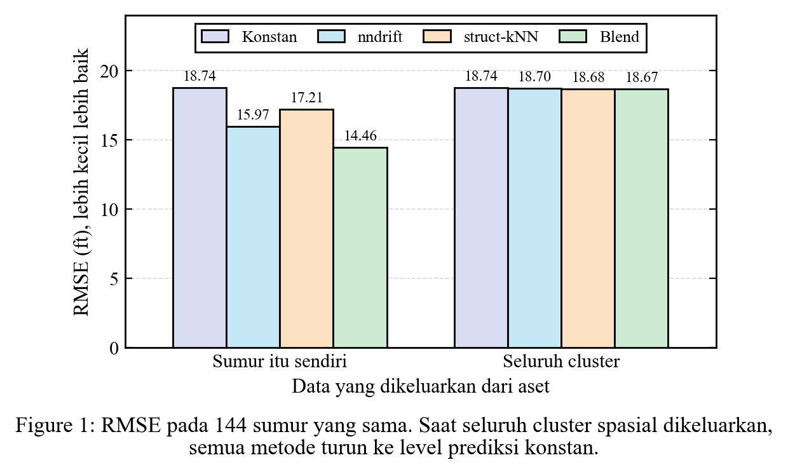
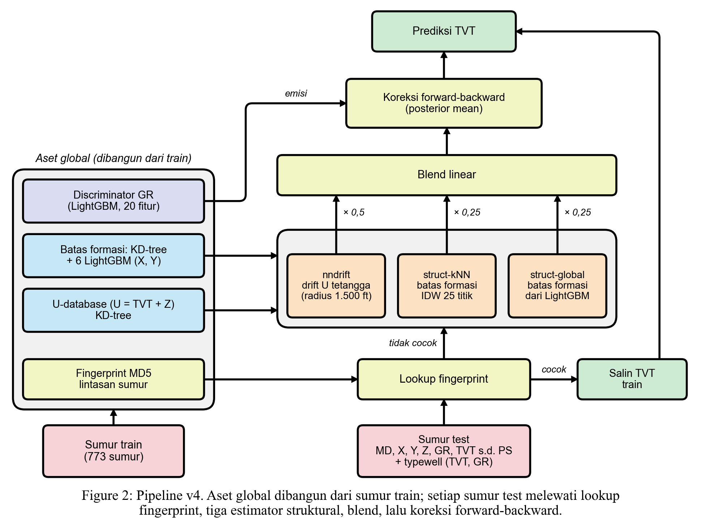
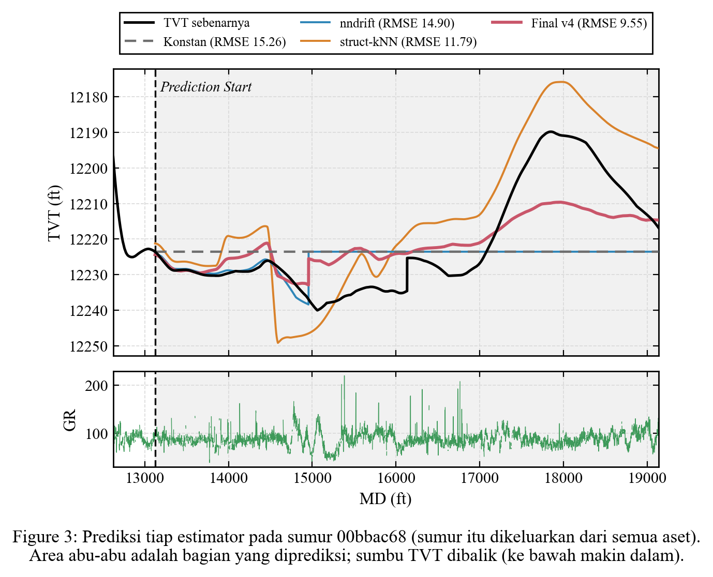

# ROGII: Wellbore Geology Prediction

Writeup tim **doremifasolasido** (ITS) untuk kompetisi kode Kaggle [ROGII - Wellbore Geology Prediction](https://www.kaggle.com/competitions/rogii-wellbore-geology-prediction) (Juli 2026). Tugasnya memprediksi posisi stratigrafi (TVT) sepanjang sumur horizontal setelah titik tertentu, berbekal lintasan sumur, log gamma ray, dan satu sumur referensi (typewell). Skor public leaderboard terakhir yang tercatat adalah RMSE 12.995 untuk versi v3; skor versi final (v4) tidak tercatat.

| | |
|---|---|
| Tugas | Regresi sekuensial: TVT per titik MD setelah Prediction Start |
| Metrik | RMSE seluruh titik prediksi (ft), lebih kecil lebih baik |
| Data | 773 sumur train, sekitar 5,1 juta baris; test tersembunyi |
| Validasi | CV per sumur, lalu CV spatial-block (KMeans 12 cluster pada koordinat sumur) |
| Skor | Public LB 13.924 (v1) → 12.995 (v3); peringkat teratas LB saat itu 4.679 |

## Masalah

Setiap sumur horizontal punya kolom `MD, X, Y, Z, GR` (kedalaman ukur, koordinat, kedalaman vertikal, gamma ray) dan `TVT_input`. TVT (true vertical thickness) diketahui sampai titik Prediction Start (PS) lalu kosong; tugasnya mengisi sisa lateral, biasanya sekitar 74% dari panjang sumur. Typewell adalah sumur vertikal di dekatnya dengan pasangan `TVT, GR`, sehingga pola gamma ray di sumur horizontal bisa dicocokkan ke kedalaman stratigrafi di typewell. Di data train ada juga enam kolom kedalaman batas formasi (`ANCC, ASTNU, ASTNL, EGFDU, EGFDL, BUDA`), tetapi kolom ini tidak tersedia di test.

Skornya adalah RMSE dari selisih TVT manual dan TVT prediksi di setiap titik dengan langkah 1 ft. Karena ini kompetisi kode, notebook dijalankan ulang oleh Kaggle pada sumur test tersembunyi, tanpa internet.

## Data

| | Train | Test lokal |
|---|---|---|
| Sumur | 773 | 3 (salinan sumur train) |
| Baris per sumur | median 6.576 (2.058-12.141) | |
| Baris yang diprediksi per sumur | median 4.840 (407-10.052) | 14.151 total |
| GR kosong | median 27,7% per sumur | |
| Baris typewell | median 1.874, langkah TVT median 0,5 ft | |

Variasi TVT di sepanjang lateral tidak besar: rentangnya median 26,4 ft, dan prediksi konstan (TVT tetap di nilai PS) sudah memberi RMSE gabungan 15,91 di seluruh train. Tiga sumur di folder test hanya placeholder yang identik dengan sumur train dengan id sama; sumur test sebenarnya baru muncul saat Kaggle menjalankan notebook. Dataset lengkap sekitar 1,3 GB; lihat [data/README.md](data/README.md).

## Temuan penting

TVT secara struktural sangat mulus. Regresi TVT terhadap Z dan enam batas formasi punya RMSE 0,03 ft, dan setelah dihaluskan 50 ft residualnya tinggal 0,09 ft. Jadi masalahnya bukan menebak noise per titik, melainkan menebak bentuk lapisan batuan di bawah sumur.

Gamma ray memang membawa informasi, tetapi inversinya tidak unik. Residual GR sekitar 9,3 unit sementara sensitivitasnya 8,4 unit GR per ft, jadi pola GR yang sama bisa cocok di beberapa kedalaman. Semua upaya inversi GR langsung (greedy, Viterbi grid halus dan kasar, Newton, pencarian banded) berakhir sekitar sama dengan prediksi konstan atau lebih buruk. Kegagalannya ada di pemilihan cabang, bukan di presisi.

Temuan terbesar justru soal validasi. CV acak per sumur membocorkan informasi lewat sumur-sumur satu pad yang letaknya berdekatan: model terlihat bagus (CV sekitar 8,8) tetapi leaderboard di 13,0. Ketika seluruh cluster spasial dikeluarkan dari data latih, semua metode turun ke level prediksi konstan:

| Data yang dikeluarkan | Konstan | nndrift | struct-kNN | Blend |
|---|---|---|---|---|
| Sumur itu sendiri | 18.74 | 15.97 | 17.21 | 14.46 |
| Seluruh cluster | 18.74 | 18.70 | 18.68 | 18.67 |

Angka di atas dihitung pada 144 sumur yang sama. Pada skema cluster, sumur terdekat yang masih boleh dipakai berjarak sekitar 555 ft.

## Pendekatan (v4)

Seluruh aset dibangun ulang dari data train saat notebook berjalan; tidak ada berkas model eksternal.

### Aset global

- U-database. Untuk setiap titik train disimpan (X, Y, U) dengan U = TVT + Z, diambil tiap 8 baris dan dimasukkan ke KD-tree. Selisih U antar titik menghapus datum per sumur, sehingga sumur tetangga bisa dipakai langsung.
- Database batas formasi (tiap 10 baris, KD-tree) dan enam regressor LightGBM dari (X, Y) ke kedalaman tiap batas formasi (300 pohon, lr 0.05, 63 leaves).
- Fingerprint MD5 lintasan sumur untuk mendeteksi sumur yang sudah ada di train.
- Discriminator LightGBM untuk koreksi GR (dijelaskan di bawah).

### Tiga estimator struktural

1. nndrift. Ambil titik tetangga dalam radius 1.500 ft dari PS. Untuk setiap baris yang diprediksi, drift = rata-rata berbobot (U − U_PS) dari maksimal 40 tetangga dengan bobot 1/((d + 40)(d_PS + 40)), dihaluskan 151 baris. Prediksi TVT = TVT_PS − (Z − Z_PS) + drift.
2. struct-kNN. Enam batas formasi diprediksi dengan inverse-distance weighting dari 25 titik terdekat (pangkat 1,5). Fitur S = rata-rata batas − Z dihaluskan 101 baris, lalu TVT ≈ a + b·S di-fit pada bagian yang sudah diketahui. Hasilnya di-gate terhadap prediksi konstan memakai sigmoid rasio RMSE pada holdout 30% terakhir sebelum PS.
3. struct-global. Sama seperti struct-kNN, tetapi batas formasi berasal dari regressor LightGBM.

Ketiganya digabung: 0,5 · nndrift + 0,25 · struct-kNN + 0,25 · struct-global.

### Koreksi forward-backward dengan discriminator GR

Lateral dipotong menjadi segmen 300 baris. Untuk setiap segmen, discriminator menilai seberapa cocok GR horizontal dengan typewell pada 15 offset (0, ±1, ±3, ±5, ±8, ±12, ±20, ±30 ft). Fiturnya 20 statistik, antara lain korelasi Pearson dan Spearman pada beberapa skala, korelasi turunan, bias amplitudo, cakupan, dan jarak dari PS. GR dikalibrasi linear per sumur terhadap typewell di bagian yang TVT-nya diketahui. Discriminator mencapai AUC OOF 0,79 dan akurasi top-1 per segmen 56,8% (korelasi mentah 46,9%, acak 20%).

Skor discriminator dipakai sebagai emisi di model state-space: state adalah offset −40 sampai +40 ft, transisi antar segmen berupa kemiringan −12 sampai +12 dengan prior Gaussian σ = 5, dan state awal dikunci di offset 0 pada PS. Yang dipakai adalah posterior mean dari forward-backward, bukan jalur Viterbi. Posterior mean menyusut ke prior saat GR ambigu; Viterbi justru memperburuk RMSE (18,2 vs 16,9 untuk konstan pada 40 sumur holdout), sedangkan posterior mean sedikit membaik (16,78) dan menang di 75% sumur.

### Pengaman

Jika fingerprint lintasan cocok dengan sumur train, TVT train disalin langsung. Nilai yang tidak finite diganti TVT_PS.

## Hasil

| Model | CV acak per sumur |
|---|---|
| Konstan | 15.0 |
| GBM residual | 12.8 |
| nndrift | 10.8 |
| Gated structural | 11.9 |
| Blend 2 estimator | 9.5 |
| Blend 3 estimator | ≈ 8.8 |

| Submission | Public LB |
|---|---|
| v1: 0,8 · GBM + 0,2 · gated structural | 13.924 |
| v3: blend tiga estimator struktural | 12.995 |
| v4: v3 + koreksi forward-backward | tidak tercatat |

GBM terlihat bagus di CV tetapi overfit pada geometri lokal (CV 12,8, LB 13,9), karena itu versi berikutnya hanya memakai estimator struktural. Gambar 3 memperlihatkan perilaku tiap estimator pada salah satu dari tiga sumur contoh. Jika ketiga sumur itu dikeluarkan dari semua aset lalu diprediksi ulang, RMSE gabungannya turun dari 11,54 (konstan) ke 7,13 untuk blend tiga estimator dan 7,20 untuk v4 lengkap. Sumur-sumur ini punya tetangga satu pad di train, jadi angkanya lebih optimis daripada leaderboard.

## Yang tidak berhasil

Ekstrapolasi dip sebelum PS (RMSE median per sumur 35,6) dan asumsi geologi datar (91) jauh lebih buruk daripada konstan (10,7). kNN pada nilai U absolut meledak karena perbedaan datum, ridge pada keenam batas formasi tidak stabil, dan semua inversi GR langsung tidak mengalahkan konstan. Rencana model sekuensial (DTW, jaringan sekuens, mixture density) tidak sempat dikerjakan.

## Menjalankan ulang

1. Unduh data ke `data/` (lihat [data/README.md](data/README.md)). Notebook mencari `data/`, `datasets/`, atau `/kaggle/input/*`.
2. Pasang numpy, pandas, scipy, dan lightgbm (versi yang dipakai: numpy 2.4.6, pandas 2.3.3, scipy 1.17.1, lightgbm 4.6.0). Tanpa lightgbm notebook tetap jalan dengan blend dua estimator tanpa discriminator.
3. Jalankan `notebook.ipynb`. Pembangunan aset sekitar 1 menit, lalu sekitar 2 sampai 4 detik per sumur.

## Isi folder

| Berkas | Keterangan |
|---|---|
| `notebook.ipynb` | Notebook submission v4 (tanpa output tersimpan) |
| `submission.csv` | Output notebook pada 3 sumur test lokal |
| `data/` | Petunjuk unduh dataset |

`submission.csv` di sini hanya contoh format. Tiga sumur test lokal adalah salinan sumur train, sehingga lookup fingerprint menyalin TVT aslinya dan RMSE-nya nol. Angka itu tidak menggambarkan kemampuan model; skor sebenarnya hanya bisa dilihat di leaderboard Kaggle.
